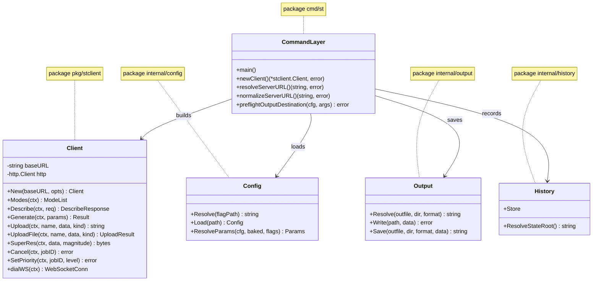
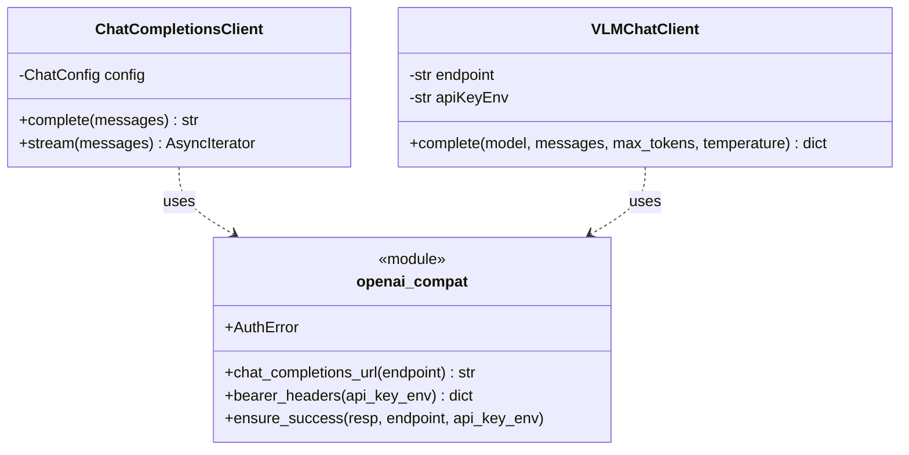

# REVIEW: CLI operational inputs — missing-value behaviour

Scope: `cli/go` (`st`), plus the server-side config elements whose absence
surfaces through `st` output. Purpose: enumerate the inputs that materially
change whether a command works, record how each currently fails, and rank the
ones that need a runtime explanation in STDERR. No fixes in this document.

## STDERR contract — current state

The contract already holds at the entry points:

| Entry point | Behaviour |
|---|---|
| `cmd/st/main.go:137-142` | Every returned error → `fmt.Fprintln(os.Stderr, "error:", err)`; exit code from `exitCodeOf`. |
| `cmd/st/main.go:32-36` | `SilenceUsage`/`SilenceErrors` on the root command, so Cobra does not duplicate or misroute errors. |
| `cmd/stcn/main.go:71-74` | Same pattern; JSON results go to the `out` writer, errors to STDERR. |
| `cmd/st/describe.go:168` | Per-run failures → `cmd.ErrOrStderr()` even with `--json`. |
| `cmd/st/gen.go:646-648` | Progress/job-id/derived-command lines → `cmd.ErrOrStderr()`. |

So all *returned* errors reach STDERR. The gap is not the stream — it is that
several high-impact inputs produce either no error or an opaque transport
error, because nothing validates them or names the source when they are absent.

## Inventory — inputs that decide whether a command works

Severity is impact of the value being absent/invalid, not frequency.

| # | Element | Source / precedence | Consumed at | Missing/invalid today | Sev |
|---|---|---|---|---|---|
| 1 | Backend base URL | `--server` > `$ST_SERVER` > config `server_url` | `main.go:62,112-134`; every client call | Empty → `Get "/api/modes": unsupported protocol scheme ""`; scheme-less host → `unsupported protocol scheme "host"` | HIGH |
| 2 | Config file | `--config` > `$ST_CONFIG` > XDG `st/config.json` | `internal/config/config.go:91-101` | Missing → template written + message (good); malformed JSON → config-dependent commands report path, but URL resolution silently ignores it | HIGH |
| 3 | `output_directory` (gen) | `-o` > config `defaults.output_directory` | `gen.go:735-748`; `internal/output/output.go:13-22` | Empty → `mkdir : no such file or directory` **after** generation; bootstrap template's `REPLACE_ME/output` silently creates that directory | HIGH |
| 4 | Analysis/chat bearer token (`api_key_env`) | server `modes.yml` connection field, default `OPENAI_API_KEY` | `server/mode_config.py:657-668`; `backends/analysis/vlm_client.py:32-37`, `backends/chat_client.py:41-43` | Unset → header silently omitted. If the endpoint enforces auth → `401 Unauthorized` wrapped as `analysis_run_failed: HTTPStatusError: ...` with no env-var name | HIGH |
| 5 | `--timeout` (describe/upload HTTP) | flag only; client default 120s | `main.go:66,129-134`; `pkg/stclient/client.go:28` | Long VLM call aborts at 120s (`Client.Timeout exceeded`) even though the server allows `timeout_s: 3600` | HIGH |
| 6 | Output path writability (`--outfile`, dir perms) | flag / config | `gen.go:743-748`; `output.Write` | Failure surfaces **after** GPU work completes | MED-HIGH |
| 7 | `mode` name (gen/switch/show) | flag > config default | `gen.go:735`? no — submitted in params; `modes.go:80-98` | `modes show` has a clear local error; `gen`/`switch` rely on server/WS text (`job error: %s`) which may be terse | MED |
| 8 | Size/`genres`, cfg, steps, seed, scheduler | config defaults < baked PNG < flags | `internal/config/precedence.go:37-120` | Validated only server-side; WS error text is the only explanation | MED |
| 9 | `output_format` | config `defaults.output_format` | `gen.go:739-743` | Unvalidated; unknown extension writes PNG bytes under that extension | MED |
| 10 | `init-image` / `recreate` local paths | flags | `gen.go:686-695`, `loadCurrentBakedParams` | `os.ReadFile` error includes path (good); `--recreate` missing baked params errors | LOW |
| 11 | `--control-image type:path`, `--control-ref` | flags | `gen.go:678-683`; `applyCurrentControlnetInputs` | Path errors clear; unknown ControlNet type only fails server-side | MED |
| 12 | ControlNet preset name (`--controlnet @name`) | config `controlnet_presets` | `gen.go` `applyCurrentControlnetInputs` | `--controlnet @X: preset not found in config` (good) | LOW |
| 13 | Describe task flags / targets | `--caption`/`--detect`, positional args | `describe.go:80-90`, `Args: MinimumNArgs(1)` | Local validation messages are exact (good) | LOW |
| 14 | Upload/superres file | positional arg | `upload.go:32-36`, `superres.go:31-40` | `os.ReadFile` error includes path (good) | LOW |
| 15 | History/state root | `$XDG_STATE_HOME` > `~/.local/state` | `internal/history/fs.go:24-41` | Unwritable root → raw `mkdir`/`chmod` error, no explanation that state is required for every command | MED |
| 16 | `validate-track3 --control-image` | flag | `validate_track3.go:38-41` | Explicit `--control-image is required` (good) | LOW |
| 17 | `modes.yml` reload | `st modes reload`, SIGHUP, watcher | server `lcm_sr_server.py:446-455` | Watcher watched the directory, not `modes.yml` → edits silently never applied (fixed in working tree, needs restart) | HIGH |

## Findings: where the explanation fails

### F1 — Backend URL: empty or scheme-less (HIGH, Bug/Robustness)

`resolveServerURL` (`main.go:112-125`) returns `""` when the flag is empty and
the config cannot be resolved or loaded. `newClient` then builds a client whose
base URL is `""`, and `stclient` concatenates paths onto it.

Observed:

```
$ env -u ST_SERVER st --config /tmp/stprobe/nodir.json modes
error: Get "/api/modes": unsupported protocol scheme ""

$ st --config /tmp/stprobe/nodir.json --server marios-laptop.local:4200 modes
error: Get "marios-laptop.local:4200/api/modes": unsupported protocol scheme "marios-laptop.local"
```

Two distinct defects share this symptom:
- no value names where the URL should come from (`--server`, `$ST_SERVER`,
  config `server_url`);
- a malformed config is swallowed at `main.go:117-123`, so the user is told
  about the URL, not the config.

### F2 — `output_directory` empty or placeholder (HIGH, Bug)

After the generation completes and the image is fetched, `gen.go:735-748`
resolves the destination. With `output_directory: ""`, `output.NextPath("")`
calls `os.MkdirAll("")`, which returns `mkdir : no such file or directory`.

Verified locally:

```
join: out-0001.png
mkdirall err: mkdir : no such file or directory
```

The bootstrap template (`internal/config/config.go:150-164`) ships
`"output_directory": "REPLACE_ME/output"`, so a user who does not edit it gets
a real `REPLACE_ME/output` directory rather than an error. Either way the bad
value is not reported before the backend is asked to generate.

### F3 — `api_key_env` missing is invisible until the remote says 401 (HIGH, Robustness)

Server-side, `AnalysisConnectionConfig.api_key_env` defaults to
`OPENAI_API_KEY` (`server/mode_config.py:657-668`). Both clients read it at
request time and omit `Authorization` when empty
(`backends/analysis/vlm_client.py:32-37`, `backends/chat_client.py:41-43`).
`docs/ANALYSIS.md:83` documents the behaviour, but nothing at runtime names the
variable.

Consequence through the CLI:

```
run caption/t1 (agent_gateway) failed: analysis_run_failed:
HTTPStatusError: Client error '401 Unauthorized' for url ...
```

The CLI correctly prints this to STDERR, but an operator cannot tell from it
that `modes.yml` names `api_key_env: AGENT_GATEWAY_TOKEN` and that the server
process lacks it. This is the element the user had to discover in docs.

### F4 — Client timeout shorter than the server's analysis budget (HIGH, Robustness)

`stclient.New` sets `http.Client{Timeout: 120s}` (`client.go:28`). The analysis
delegate in `modes.yml` allows `timeout_s: 3600`. `st describe` performs the
whole `/v1/describe` call inside that 120s client timeout, so a slow VLM is
reported as a transport error (or, for handlers that respect context, as a
deadline) rather than as a long-running analysis. `--timeout` can raise it, but
the failure text does not mention that.

### F5 — Failures after expensive work (MED-HIGH, Robustness)

Both `output.Resolve`/`output.Write` (`gen.go:743-748`) and the explicit
`--outfile` path run *after* the WebSocket job completes and the image is
fetched. An unwritable directory or bad explicit path costs a full generation.
`output.Resolve` also does not create the parent directory for an explicit
`--outfile`, unlike `NextPath`, so the two paths behave differently.

### F6 — Server/WS errors are opaque passthroughs (MED, Robustness)

`pkg/stclient/ws.go:61,100` formats `job error: %s` from the frame's `Error`
field. When the server supplies a terse or empty string, the CLI emits
`job error: ` with no code, mode, or parameter named. Invalid mode name,
size, scheduler, or unsupported model all arrive through this path.

### F7 — State root failure lacks context (MED, Robustness)

`internal/history/fs.go:24-41` creates `$XDG_STATE_HOME/st` or
`~/.local/state/st`. A permission/mount failure returns the raw `mkdir` error.
Every `st` invocation (including `modes`, `upload`) reserves an ID first
(`history_runtime.go:84-92`), so an unwritable state root blocks commands that
need no history at all.

### F8 — `modes.yml` hot reload silently inert (HIGH, Bug — fixed in tree)

`start_config_watcher(MODE_CONFIG_PATH, ...)` received the directory (`conf`),
while `ModeConfigManager` resolves `conf/modes.yml` (`mode_config.py:218`).
The watcher therefore compared events against a directory and never matched.
Operators saw config edits "not take effect" with no error; `st modes reload`
was the only workaround. Fixed at `server/lcm_sr_server.py:455`; a server
restart is required.

## Candidate runtime explanations (for decision, not implemented)

Ordered by impact. Each is phrased as what STDERR should say.

1. **Validate the backend URL before the first request.**
   `error: no backend URL: set --server, $ST_SERVER, or server_url in <config>\n       example: export ST_SERVER=http://host:4200`
   Also accept a scheme-less host by normalizing to `http://`, and surface
   config parse errors instead of swallowing them.

2. **Preflight the gen output destination before submitting the job.**
   `error: output_directory is empty; set defaults.output_directory in <config> or pass -o <dir>`
   `error: output_directory "<dir>" is not writable: <os error>`
   Reject the untouched `REPLACE_ME/output` template value explicitly.

3. **Name the credential variable on 401/403.**
   In the analysis/chat provider, wrap auth failures with:
   `401 Unauthorized from <endpoint>; connection '<name>' reads its bearer token from <ENV VAR>, which is unset or rejected`
   The CLI already prints the run message to STDERR, so this needs no CLI change.

4. **Make the timeout relationship explicit.**
   Either give `st describe` a default >= the delegate's `timeout_s`, or on
   deadline failure say:
   `error: describe exceeded the client timeout (120s); raise it with --timeout 30m`
   Audit whether `--timeout` governs WebSocket job duration as well as the
   handshake; today that is not stated anywhere.

5. **Enrich WS job errors.** When `job:error` lacks a code, include the mode
   and the offending parameter if the server frame carries them; otherwise
   say `job error (no detail from server); run 'st modes show <mode>'`.

6. **State root.** Include the resolved path and the variable in the error:
   `error: cannot initialise state directory <path> ($XDG_STATE_HOME): <os error>`.

7. **Usage errors.** For argument-count/flag-validation failures, print the
   specific `st <cmd> --help` hint to STDERR so the user does not need to
   guess which flag is missing. (Cobra's default text is already on STDERR;
   this is an enrichment, not a stream fix.)

## Relevant server-side elements (surfaced through `st`)

| Element | Location | Effect on CLI |
|---|---|---|
| `analysis_connections.<n>.endpoint` | `server/mode_config.py:657-668` | Wrong scheme (http vs TLS-only port) reaches the CLI as a provider HTTP error |
| `analysis_delegates.<n>.model` | `server/mode_config.py:672+` | Unknown model → provider 4xx inside `analysis_run_failed` |
| `analysis_delegates.<n>.options.max_tokens` | same | Reasoning models can consume the whole budget and return `content: null` → `VLM response missing choices[0].message.content` |
| `chat_connections` / `chat_delegates` | `server/mode_config.py:51-66, 1015-1040` | Same auth/timeout classes for `sdxl_advisor` |
| `MODE_CONFIG_PATH` | `server/mode_config.py:22` | Directory vs file ambiguity that caused F8 |

## Out of scope

- No CLI authentication for the Stability-Toys backend exists; `AUTH_TOKEN`
  here means the outbound bearer token to an analysis/chat provider.
- `stcn` (control-net helper) shares the entry-point STDERR pattern and the
  same missing-URL behaviour, via the same `stclient`.

## Resolution status — branch `fix/cli-operational-inputs`

| Finding | Change | Where |
|---|---|---|
| F1 backend URL | `resolveServerURL` returns errors; `normalizeServerURL` accepts scheme-less hosts; `newClient` returns `(*Client, error)` | `cmd/st/main.go` |
| F2 output destination | `outputDestination` + `preflightOutputDestination` run before submit; reject empty/`REPLACE_ME`/non-PNG | `cmd/st/gen.go` |
| F3 auth token | `openai_compat.ensure_success` raises `AuthError` naming endpoint + `api_key_env`; both clients use it | `backends/openai_compat.py`, `backends/chat_client.py`, `backends/analysis/vlm_client.py` |
| F4 timeout | describe defaults to 30m; timeout failures include a `--timeout` hint; flag help states WS jobs are not capped | `cmd/st/describe.go`, `cmd/st/main.go` |
| F5 post-generation failure | output preflight + `output.Save` | `cmd/st/gen.go`, `cmd/st/superres.go`, `internal/output/output.go` |
| F6 opaque WS errors | `jobFailure` adds mode and a missing-detail fallback | `pkg/stclient/ws.go` |
| F7 state root | mkdir/chmod errors name the path and `$XDG_STATE_HOME` | `internal/history/fs.go` |
| F8 reload watcher | watches `mode_config.config_path` (already fixed in tree) | `server/lcm_sr_server.py` |

Usage errors now print `hint: run 'st <cmd> --help'` on STDERR via
`usageError`, including Cobra flag-parse and positional-argument failures.

## Architecture round — duplicated multi-line routines

Scan scope: `cli/go` and the two OpenAI-compatible Python clients.

Found and abstracted:

| Duplicated routine block | Copies | Abstraction |
|---|---|---|
| Base-URL join + bearer header construction + status check | `backends/chat_client.py` (`complete`, `stream`), `backends/analysis/vlm_client.py` (`complete`) | `backends/openai_compat.py`: `chat_completions_url`, `bearer_headers`, `ensure_success` |
| `output.Resolve` + `output.Write` + two error checks | `cmd/st/gen.go`, `cmd/st/superres.go` | `internal/output.Save` |
| WebSocket dial with the shared HTTP transport | `pkg/stclient/ws.go` `Generate`, `controlFrame` | `(*Client).dialWS` |

Re-scan after extraction: no multi-line duplicated routines remain in the
touched packages. Three repeated *call-site* shapes remain but are not
routines: `client, err := newClient()` preambles, `emitJSON` invocations, and
cobra flag registrations.

### Class diagram — Go CLI



### Class diagram — provider clients (server side)


