# S3.6 CAD acceptance

OpenSCAD: `OpenSCAD version 2021.01`.
Work directory: `/private/tmp/s36-cad-final5`.

Regenerate from the repository root with an empty work directory: `python -m tests.vector_map_s3_6_cad_probe --work-dir /private/tmp/s36-cad-review --evidence-json /private/tmp/s36-cad-review.json --report /private/tmp/s36-cad-review.md --preview-dir /private/tmp/s36-cad-review-previews`.
The JSON preserves the exact argv used for this run.
Reproduce individual conversions and renders with the exact argv in each case's JSON record.

Result: 15/15 cases passed.
Manifest artifact hashes: 115 checked, 0 mismatches.
OpenSCAD may return exit 0 while reporting a non-closed or non-manifold mesh; those diagnostics fail a CAD row.
The blocking volume check uses effective areas: the regions the generated SCAD extrudes, exported by OpenSCAD as 2D with DETAIL_GROW forced to zero. Engraved volume uses detail_2d(), not the unclipped engraving cut. This derives the expectation from the SCAD and OpenSCAD, so it checks the 3D assembly, heights and closure but not the 2D clip itself. Bounds, solid count, genus and Z planes stay independent checks.
Each row also records the published-area figure (the sum of the published SVG areas times the heights) and its excess over the effective figure. The published figure overcounts material that structure or detail loses to clipping, so it is evidence and not a blocking check.

| Case | CAD result |
|---|---|
| raised_backed | PASS |
| engraved | PASS |
| islands_loose | PASS |
| islands_backed | PASS |
| donut_open | PASS |
| donut_filled | PASS |
| preset | PASS |
| corpus_badge | PASS |
| corpus_bracket | PASS |
| corpus_brick | PASS |
| corpus_coins | PASS |
| corpus_gravel | PASS |
| corpus_horse | PASS |
| corpus_pcb | PASS |
| corpus_truchet | PASS |

## raised_backed

Result: PASS.

Conversion command: `python scripts/vector_map.py /private/tmp/s36-cad-final5/raised_backed/source.png /private/tmp/s36-cad-final5/raised_backed/out.svg --input-kind image --mask /private/tmp/s36-cad-final5/raised_backed/mask.png --width-mm 32 --layers silhouette,structure,detail --structure-map /private/tmp/s36-cad-final5/raised_backed/structure.png --detail-map /private/tmp/s36-cad-final5/raised_backed/detail.png --silhouette-thickness-mm 2 --structure-height-mm 1 --detail-height-mm 0.5 --backing-mm 1 --export-scad --debug-bundle --json`.
Conversion exit: 0.
OpenSCAD command: `/Applications/OpenSCAD-2021.01.app/Contents/MacOS/OpenSCAD -o /private/tmp/s36-cad-final5/raised_backed/out.stl /private/tmp/s36-cad-final5/raised_backed/out.scad`.
OpenSCAD exit: 0.
Expected: `{"areas_mm2": {"canvas": 768.0, "detail": 60.0, "silhouette": 560.0, "structure": 72.0}, "bounds_xy": [[0.0, 0.0], [32.0, 24.0]], "genus_sum": 0, "published_areas_mm2": {"canvas": 768.0, "detail": 60.0, "silhouette": 560.0, "structure": 72.0}, "published_volume_excess": 0.0, "published_volume_mm3": 1990.0, "solids": 1, "volume_basis": "effective_openscad_2d", "volume_mm3": 1990.0, "z_max": 4.0}`.
Measured: `{"bounds": [[0.0, 0.0, 0.0], [32.0, 24.0, 4.0]], "genus_per_solid": [0], "genus_sum": 0, "solids": 1, "volume_mm3": 1990.0, "z_planes": [0.0, 1.0, 3.0, 3.5, 4.0]}`.
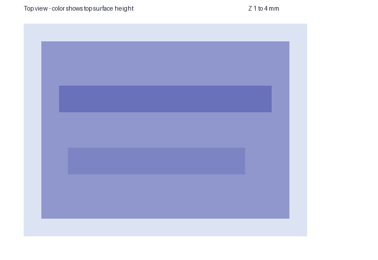

## engraved

Result: PASS.

Conversion command: `python scripts/vector_map.py /private/tmp/s36-cad-final5/engraved/source.png /private/tmp/s36-cad-final5/engraved/out.svg --input-kind image --mask /private/tmp/s36-cad-final5/engraved/mask.png --width-mm 32 --layers silhouette,structure,detail --structure-map /private/tmp/s36-cad-final5/engraved/structure.png --detail-map /private/tmp/s36-cad-final5/engraved/detail.png --silhouette-thickness-mm 2 --structure-height-mm 1 --detail-height-mm 0.5 --detail-mode engraved --export-scad --debug-bundle --json`.
Conversion exit: 0.
OpenSCAD command: `/Applications/OpenSCAD-2021.01.app/Contents/MacOS/OpenSCAD -o /private/tmp/s36-cad-final5/engraved/out.stl /private/tmp/s36-cad-final5/engraved/out.scad`.
OpenSCAD exit: 0.
Expected: `{"areas_mm2": {"canvas": 768.0, "detail": 60.0, "silhouette": 560.0, "structure": 72.0}, "bounds_xy": [[2.0, 2.0], [30.0, 22.0]], "filter_speckle_px": 4, "genus_sum": 0, "mask_solids": 1, "published_areas_mm2": {"canvas": 768.0, "detail": 60.0, "silhouette": 560.0, "structure": 72.0}, "published_volume_excess": 0.0, "published_volume_mm3": 1162.0, "solids": 1, "volume_basis": "effective_openscad_2d", "volume_mm3": 1162.0, "z_max": 3.0}`.
Measured: `{"bounds": [[2.0, 2.0, 0.0], [30.0, 22.0, 3.0]], "genus_per_solid": [0], "genus_sum": 0, "sample_tops": {"recess": 1.5, "ridge": 3.0}, "solids": 1, "volume_mm3": 1162.0, "z_planes": [0.0, 1.5, 2.0, 3.0]}`.
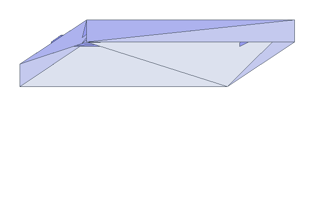

## islands_loose

Result: PASS.

Conversion command: `python scripts/vector_map.py /private/tmp/s36-cad-final5/islands_loose/source.png /private/tmp/s36-cad-final5/islands_loose/out.svg --input-kind image --mask /private/tmp/s36-cad-final5/islands_loose/mask.png --width-mm 32 --layers silhouette --silhouette-thickness-mm 2 --export-scad --debug-bundle --json`.
Conversion exit: 0.
OpenSCAD command: `/Applications/OpenSCAD-2021.01.app/Contents/MacOS/OpenSCAD -o /private/tmp/s36-cad-final5/islands_loose/out.stl /private/tmp/s36-cad-final5/islands_loose/out.scad`.
OpenSCAD exit: 0.
Expected: `{"areas_mm2": {"canvas": 768.0, "silhouette": 198.0}, "bounds_xy": [[2.0, 2.0], [30.0, 22.0]], "filter_speckle_px": 4, "genus_sum": 0, "mask_solids": 2, "published_areas_mm2": {"canvas": 768.0, "silhouette": 198.0}, "published_volume_excess": 0.0, "published_volume_mm3": 396.0, "solids": 2, "volume_basis": "effective_openscad_2d", "volume_mm3": 396.0, "z_max": 2.0}`.
Measured: `{"bounds": [[2.0, 2.0, 0.0], [30.0, 22.0, 2.0]], "genus_per_solid": [0, 0], "genus_sum": 0, "solids": 2, "volume_mm3": 396.0, "z_planes": [0.0, 2.0]}`.
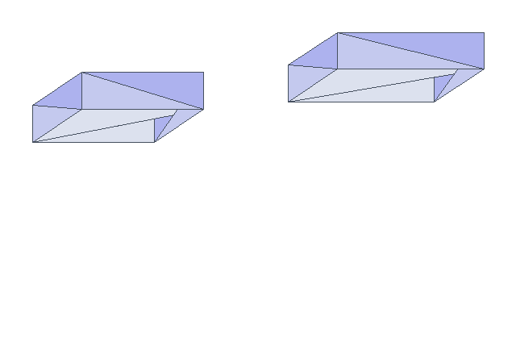

## islands_backed

Result: PASS.

Conversion command: `python scripts/vector_map.py /private/tmp/s36-cad-final5/islands_backed/source.png /private/tmp/s36-cad-final5/islands_backed/out.svg --input-kind image --mask /private/tmp/s36-cad-final5/islands_backed/mask.png --width-mm 32 --layers silhouette --silhouette-thickness-mm 2 --backing-mm 1 --export-scad --debug-bundle --json`.
Conversion exit: 0.
OpenSCAD command: `/Applications/OpenSCAD-2021.01.app/Contents/MacOS/OpenSCAD -o /private/tmp/s36-cad-final5/islands_backed/out.stl /private/tmp/s36-cad-final5/islands_backed/out.scad`.
OpenSCAD exit: 0.
Expected: `{"areas_mm2": {"canvas": 768.0, "silhouette": 198.0}, "bounds_xy": [[0.0, 0.0], [32.0, 24.0]], "genus_sum": 0, "published_areas_mm2": {"canvas": 768.0, "silhouette": 198.0}, "published_volume_excess": 0.0, "published_volume_mm3": 1164.0, "solids": 1, "volume_basis": "effective_openscad_2d", "volume_mm3": 1164.0, "z_max": 3.0}`.
Measured: `{"bounds": [[0.0, 0.0, 0.0], [32.0, 24.0, 3.0]], "genus_per_solid": [0], "genus_sum": 0, "solids": 1, "volume_mm3": 1164.0, "z_planes": [0.0, 1.0, 3.0]}`.
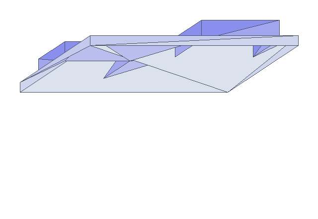

## donut_open

Result: PASS.

Conversion command: `python scripts/vector_map.py /private/tmp/s36-cad-final5/donut_open/source.png /private/tmp/s36-cad-final5/donut_open/out.svg --input-kind image --mask /private/tmp/s36-cad-final5/donut_open/mask.png --width-mm 32 --layers silhouette --silhouette-thickness-mm 2 --export-scad --debug-bundle --json`.
Conversion exit: 0.
OpenSCAD command: `/Applications/OpenSCAD-2021.01.app/Contents/MacOS/OpenSCAD -o /private/tmp/s36-cad-final5/donut_open/out.stl /private/tmp/s36-cad-final5/donut_open/out.scad`.
OpenSCAD exit: 0.
Expected: `{"areas_mm2": {"canvas": 768.0, "silhouette": 480.0}, "bounds_xy": [[2.0, 2.0], [30.0, 22.0]], "filter_speckle_px": 4, "genus_sum": 1, "mask_solids": 1, "published_areas_mm2": {"canvas": 768.0, "silhouette": 480.0}, "published_volume_excess": 0.0, "published_volume_mm3": 960.0, "solids": 1, "volume_basis": "effective_openscad_2d", "volume_mm3": 960.0, "z_max": 2.0}`.
Measured: `{"bounds": [[2.0, 2.0, 0.0], [30.0, 22.0, 2.0]], "genus_per_solid": [1], "genus_sum": 1, "solids": 1, "volume_mm3": 960.0, "z_planes": [0.0, 2.0]}`.
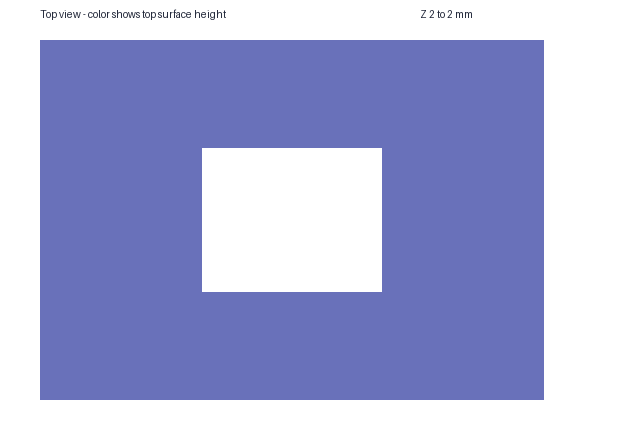

## donut_filled

Result: PASS.

Conversion command: `python scripts/vector_map.py /private/tmp/s36-cad-final5/donut_filled/source.png /private/tmp/s36-cad-final5/donut_filled/out.svg --input-kind image --mask /private/tmp/s36-cad-final5/donut_filled/mask.png --width-mm 32 --layers silhouette --silhouette-thickness-mm 2 --backing-mm 1 --export-scad --debug-bundle --json`.
Conversion exit: 0.
OpenSCAD command: `/Applications/OpenSCAD-2021.01.app/Contents/MacOS/OpenSCAD -o /private/tmp/s36-cad-final5/donut_filled/out.stl /private/tmp/s36-cad-final5/donut_filled/out.scad`.
OpenSCAD exit: 0.
Expected: `{"areas_mm2": {"canvas": 768.0, "silhouette": 480.0}, "bounds_xy": [[0.0, 0.0], [32.0, 24.0]], "genus_sum": 0, "published_areas_mm2": {"canvas": 768.0, "silhouette": 480.0}, "published_volume_excess": 0.0, "published_volume_mm3": 1728.0, "solids": 1, "volume_basis": "effective_openscad_2d", "volume_mm3": 1728.0, "z_max": 3.0}`.
Measured: `{"bounds": [[0.0, 0.0, 0.0], [32.0, 24.0, 3.0]], "genus_per_solid": [0], "genus_sum": 0, "solids": 1, "volume_mm3": 1728.0, "z_planes": [0.0, 1.0, 3.0]}`.
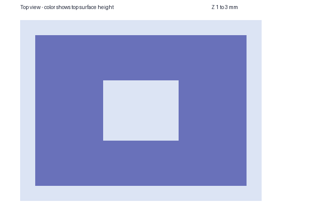

## preset

Result: PASS.

Conversion command: `python scripts/vector_map.py /private/tmp/s36-cad-final5/preset/source.png /private/tmp/s36-cad-final5/preset/out.svg --input-kind image --mask /private/tmp/s36-cad-final5/preset/mask.png --width-mm 32 --layers silhouette,structure,detail --structure-map /private/tmp/s36-cad-final5/preset/structure.png --detail-map /private/tmp/s36-cad-final5/preset/detail.png --preset relief-0.4 --export-scad --debug-bundle --json`.
Conversion exit: 0.
OpenSCAD command: `/Applications/OpenSCAD-2021.01.app/Contents/MacOS/OpenSCAD -o /private/tmp/s36-cad-final5/preset/out.stl /private/tmp/s36-cad-final5/preset/out.scad`.
OpenSCAD exit: 0.
Expected: `{"areas_mm2": {"canvas": 768.0, "detail": 60.0, "silhouette": 560.0, "structure": 72.0}, "bounds_xy": [[2.0, 2.0], [30.0, 22.0]], "filter_speckle_px": 4, "genus_sum": 0, "mask_solids": 1, "published_areas_mm2": {"canvas": 768.0, "detail": 60.0, "silhouette": 560.0, "structure": 72.0}, "published_volume_excess": 0.0, "published_volume_mm3": 727.2, "solids": 1, "volume_basis": "effective_openscad_2d", "volume_mm3": 727.2, "z_max": 1.7999999999999998}`.
Measured: `{"bounds": [[2.0, 2.0, 0.0], [30.0, 22.0, 1.8]], "genus_per_solid": [0], "genus_sum": 0, "solids": 1, "volume_mm3": 727.1999999999999, "z_planes": [0.0, 1.2, 1.4, 1.8]}`.
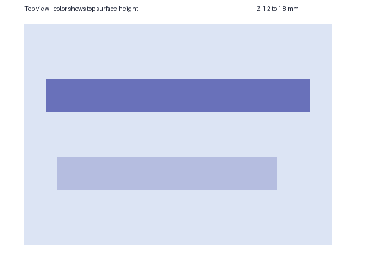

## corpus_badge

Result: PASS.

Conversion command: `python scripts/vector_map.py /private/tmp/s36-cad-final5/corpus_badge/source.png /private/tmp/s36-cad-final5/corpus_badge/out.svg --input-kind image --mask /private/tmp/s36-cad-final5/corpus_badge/mask.png --width-mm 100 --layers silhouette,structure,detail --preset relief-0.4 --export-scad --debug-bundle --json`.
Conversion exit: 0.
OpenSCAD command: `/Applications/OpenSCAD-2021.01.app/Contents/MacOS/OpenSCAD -o /private/tmp/s36-cad-final5/corpus_badge/out.stl /private/tmp/s36-cad-final5/corpus_badge/out.scad`.
OpenSCAD exit: 0.
Expected: `{"areas_mm2": {"canvas": 10000.0, "detail": 0.0, "silhouette": 3456.4981005910486, "structure": 531.3920458822502}, "bounds_xy": [[3.90625, 3.90625], [96.09375, 96.09375]], "filter_speckle_px": 4, "genus_sum": 2, "mask_solids": 6, "published_areas_mm2": {"canvas": 10000.0, "detail": 0.0, "silhouette": 3456.4971923828125, "structure": 531.3873291015625}, "published_volume_excess": -8.776002731983289e-07, "published_volume_mm3": 4466.6290283203125, "solids": 6, "volume_basis": "effective_openscad_2d", "volume_mm3": 4466.632948238608, "z_max": 1.7999999999999998}`.
Measured: `{"bounds": [[3.90625, 3.90625, 0.0], [96.0938, 96.0938, 1.8]], "genus_per_solid": [0, 0, 1, 1, 0, 0], "genus_sum": 2, "solids": 6, "volume_mm3": 4466.632948238609, "z_planes": [0.0, 1.2, 1.8]}`.

## corpus_bracket

Result: PASS.

Conversion command: `python scripts/vector_map.py /private/tmp/s36-cad-final5/corpus_bracket/source.png /private/tmp/s36-cad-final5/corpus_bracket/out.svg --input-kind image --mask /private/tmp/s36-cad-final5/corpus_bracket/mask.png --width-mm 100 --layers silhouette,structure,detail --preset relief-0.4 --export-scad --debug-bundle --json`.
Conversion exit: 0.
OpenSCAD command: `/Applications/OpenSCAD-2021.01.app/Contents/MacOS/OpenSCAD -o /private/tmp/s36-cad-final5/corpus_bracket/out.stl /private/tmp/s36-cad-final5/corpus_bracket/out.scad`.
OpenSCAD exit: 0.
Expected: `{"areas_mm2": {"canvas": 10000.0, "detail": 0.0, "silhouette": 549.1463769450003, "structure": 543.1952148350002}, "bounds_xy": [[11.71875, 17.96875], [88.28125, 90.234375]], "filter_speckle_px": 4, "genus_sum": 3, "mask_solids": 6, "published_areas_mm2": {"canvas": 10000.0, "detail": 0.0, "silhouette": 549.163818359375, "structure": 543.212890625}, "published_volume_excess": 3.201888758893372e-05, "published_volume_mm3": 984.92431640625, "solids": 6, "volume_basis": "effective_openscad_2d", "volume_mm3": 984.8927812350005, "z_max": 1.7999999999999998}`.
Measured: `{"bounds": [[11.7188, 17.9688, 0.0], [88.2812, 90.2344, 1.8]], "genus_per_solid": [0, 1, 1, 0, 1, 0], "genus_sum": 3, "solids": 6, "volume_mm3": 984.8927812349983, "z_planes": [0.0, 1.2, 1.8]}`.

## corpus_brick

Result: PASS.

Conversion command: `python scripts/vector_map.py /private/tmp/s36-cad-final5/corpus_brick/source.png /private/tmp/s36-cad-final5/corpus_brick/out.svg --input-kind image --mask /private/tmp/s36-cad-final5/corpus_brick/mask.png --width-mm 100 --layers silhouette,structure,detail --preset relief-0.4 --export-scad --debug-bundle --json`.
Conversion exit: 0.
OpenSCAD command: `/Applications/OpenSCAD-2021.01.app/Contents/MacOS/OpenSCAD -o /private/tmp/s36-cad-final5/corpus_brick/out.stl /private/tmp/s36-cad-final5/corpus_brick/out.scad`.
OpenSCAD exit: 0.
Expected: `{"areas_mm2": {"canvas": 10000.0, "detail": 3.8146972649992676, "silhouette": 1955.7244179543031, "structure": 1921.2277890867997}, "bounds_xy": [[0.0, 0.0], [100.0, 100.0]], "filter_speckle_px": 4, "genus_sum": 53, "mask_solids": 1, "published_areas_mm2": {"canvas": 10000.0, "detail": 3.814697265625, "silhouette": 1955.718994140625, "structure": 1933.2122802734375}, "published_volume_excess": 0.0020524082778922217, "published_volume_mm3": 3507.5531005859375, "solids": 1, "volume_basis": "effective_openscad_2d", "volume_mm3": 3500.368914450243, "z_max": 1.7999999999999998}`.
Measured: `{"bounds": [[0.0, 0.0, 0.0], [100.0, 100.0, 1.8]], "genus_per_solid": [53], "genus_sum": 53, "solids": 1, "volume_mm3": 3500.3710669296065, "z_planes": [0.0, 1.19, 1.2, 1.4, 1.8]}`.
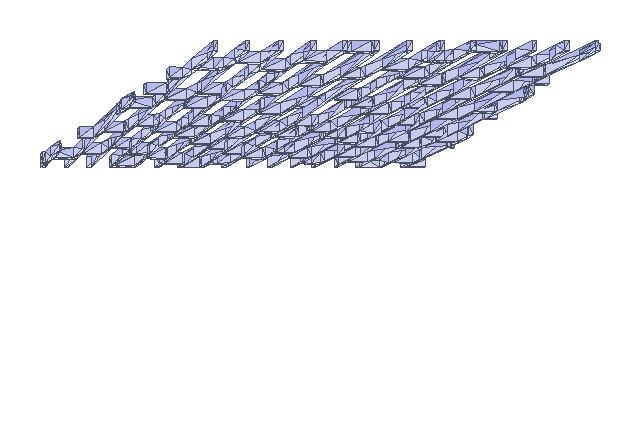

## corpus_coins

Result: PASS.

Conversion command: `python scripts/vector_map.py /private/tmp/s36-cad-final5/corpus_coins/source.png /private/tmp/s36-cad-final5/corpus_coins/out.svg --input-kind image --mask /private/tmp/s36-cad-final5/corpus_coins/mask.png --width-mm 100 --layers silhouette,structure,detail --preset relief-0.4 --export-scad --debug-bundle --json`.
Conversion exit: 0.
OpenSCAD command: `/Applications/OpenSCAD-2021.01.app/Contents/MacOS/OpenSCAD -o /private/tmp/s36-cad-final5/corpus_coins/out.stl /private/tmp/s36-cad-final5/corpus_coins/out.scad`.
OpenSCAD exit: 0.
Expected: `{"areas_mm2": {"canvas": 7890.625, "detail": 927.6840218023989, "silhouette": 2804.4956552823023, "structure": 1364.1035110053058}, "bounds_xy": [[4.6875, 3.515625], [99.609375, 75.0]], "filter_speckle_px": 4, "genus_sum": 0, "mask_solids": 24, "published_areas_mm2": {"canvas": 7890.625, "detail": 957.6723947906495, "silhouette": 2804.4891357421875, "structure": 1364.096130065918}, "published_volume_excess": 0.0013698519750177554, "published_volume_mm3": 4375.3791198883055, "solids": 24, "volume_basis": "effective_openscad_2d", "volume_mm3": 4369.393697302426, "z_max": 1.7999999999999998}`.
Measured: `{"bounds": [[4.6875, 3.51562, 0.0], [99.6094, 75.0, 1.8]], "genus_per_solid": [0, 0, 0, 0, 0, 0, 0, 0, 0, 0, 0, 0, 0, 0, 0, 0, 0, 0, 0, 0, 0, 0, 0, 0], "genus_sum": 0, "solids": 24, "volume_mm3": 4369.690693448704, "z_planes": [0.0, 1.2, 1.4, 1.8]}`.
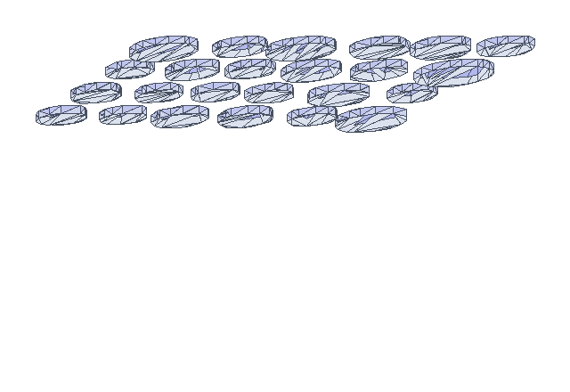

## corpus_gravel

Result: PASS.

Conversion command: `python scripts/vector_map.py /private/tmp/s36-cad-final5/corpus_gravel/source.png /private/tmp/s36-cad-final5/corpus_gravel/out.svg --input-kind image --mask /private/tmp/s36-cad-final5/corpus_gravel/mask.png --width-mm 100 --layers silhouette,structure,detail --preset relief-0.4 --export-scad --debug-bundle --json`.
Conversion exit: 0.
OpenSCAD command: `/Applications/OpenSCAD-2021.01.app/Contents/MacOS/OpenSCAD -o /private/tmp/s36-cad-final5/corpus_gravel/out.stl /private/tmp/s36-cad-final5/corpus_gravel/out.scad`.
OpenSCAD exit: 0.
Expected: `{"areas_mm2": {"canvas": 10000.0, "detail": 141.6802690101533, "silhouette": 4284.974690468046, "structure": 3122.474561648045}, "bounds_xy": [[0.0, 0.0], [100.0, 100.0]], "filter_speckle_px": 4, "genus_sum": 13, "mask_solids": 225, "published_areas_mm2": {"canvas": 10000.0, "detail": 160.369873046875, "silhouette": 4284.97314453125, "structure": 3169.650972366333}, "published_volume_excess": 0.004548958757507793, "published_volume_mm3": 7075.832331466675, "solids": 209, "volume_basis": "effective_openscad_2d", "volume_mm3": 7043.790419352512, "z_max": 1.7999999999999998}`.
Measured: `{"bounds": [[0.0, 0.0, 0.0], [100.0, 100.0, 1.8]], "genus_per_solid": [0, 0, 0, 0, 0, 0, 0, 0, 0, 0, 0, 0, 0, 0, 0, 0, 0, 0, 0, 0, 0, 0, 0, 0, 0, 0, 0, 0, 0, 0, 0, 0, 0, 1, 0, 0, 0, 0, 0, 0, 0, 0, 0, 0, 1, 0, 0, 0, 0, 0, 0, 0, 0, 0, 0, 1, 0, 0, 0, 0, 0, 0, 0, 0, 0, 0, 0, 0, 0, 0, 0, 0, 0, 0, 0, 0, 0, 0, 0, 0, 0, 0, 0, 0, 0, 0, 0, 0, 0, 0, 0, 0, 0, 0, 0, 0, 0, 0, 2, 0, 0, 0, 0, 0, 0, 0, 0, 0, 0, 0, 0, 0, 0, 3, 0, 0, 0, 0, 0, 0, 0, 0, 0, 0, 0, 0, 0, 2, 0, 0, 0, 0, 0, 0, 0, 0, 0, 0, 0, 0, 0, 0, 0, 1, 0, 0, 2, 0, 0, 0, 0, 0, 0, 0, 0, 0, 0, 0, 0, 0, 0, 0, 0, 0, 0, 0, 0, 0, 0, 0, 0, 0, 0, 0, 0, 0, 0, 0, 0, 0, 0, 0, 0, 0, 0, 0, 0, 0, 0, 0, 0, 0, 0, 0, 0, 0, 0, 0, 0, 0, 0, 0, 0, 0, 0, 0, 0, 0, 0], "genus_sum": 13, "solids": 209, "volume_mm3": 7043.874851818953, "z_planes": [0.0, 1.19, 1.2, 1.4, 1.8]}`.
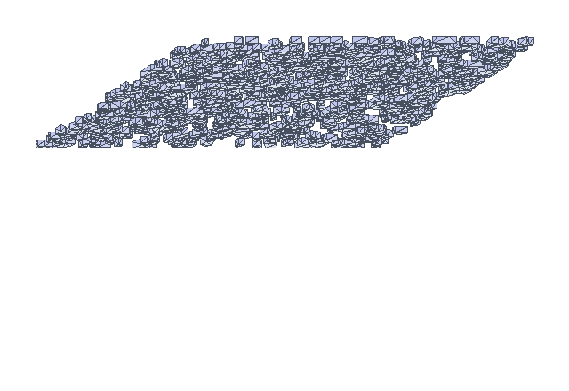

## corpus_horse

Result: PASS.

Conversion command: `python scripts/vector_map.py /private/tmp/s36-cad-final5/corpus_horse/source.png /private/tmp/s36-cad-final5/corpus_horse/out.svg --input-kind image --mask /private/tmp/s36-cad-final5/corpus_horse/mask.png --width-mm 100 --layers silhouette,structure,detail --preset relief-0.4 --export-scad --debug-bundle --json`.
Conversion exit: 0.
OpenSCAD command: `/Applications/OpenSCAD-2021.01.app/Contents/MacOS/OpenSCAD -o /private/tmp/s36-cad-final5/corpus_horse/out.stl /private/tmp/s36-cad-final5/corpus_horse/out.scad`.
OpenSCAD exit: 0.
Expected: `{"areas_mm2": {"canvas": 8203.125, "detail": 0.0, "silhouette": 2803.726415039499, "structure": 370.78709765349777}, "bounds_xy": [[4.296875, 3.90625], [97.265625, 79.6875]], "filter_speckle_px": 4, "genus_sum": 0, "mask_solids": 1, "published_areas_mm2": {"canvas": 8203.125, "detail": 0.0, "silhouette": 2803.7261962890625, "structure": 370.78857421875}, "published_volume_excess": 1.738077414542674e-07, "published_volume_mm3": 3586.944580078125, "solids": 1, "volume_basis": "effective_openscad_2d", "volume_mm3": 3586.943956639497, "z_max": 1.7999999999999998}`.
Measured: `{"bounds": [[4.29688, 3.90625, 0.0], [97.2656, 79.6875, 1.8]], "genus_per_solid": [0], "genus_sum": 0, "solids": 1, "volume_mm3": 3586.9439566395, "z_planes": [0.0, 1.2, 1.8]}`.

## corpus_pcb

Result: PASS.

Conversion command: `python scripts/vector_map.py /private/tmp/s36-cad-final5/corpus_pcb/source.png /private/tmp/s36-cad-final5/corpus_pcb/out.svg --input-kind image --mask /private/tmp/s36-cad-final5/corpus_pcb/mask.png --width-mm 100 --layers silhouette,structure,detail --preset relief-0.4 --export-scad --debug-bundle --json`.
Conversion exit: 0.
OpenSCAD command: `/Applications/OpenSCAD-2021.01.app/Contents/MacOS/OpenSCAD -o /private/tmp/s36-cad-final5/corpus_pcb/out.stl /private/tmp/s36-cad-final5/corpus_pcb/out.scad`.
OpenSCAD exit: 0.
Expected: `{"areas_mm2": {"canvas": 10000.0, "detail": 0.0, "silhouette": 2207.4907090049996, "structure": 1585.2894975080446}, "bounds_xy": [[5.859375, 5.46875], [94.53125, 94.140625]], "filter_speckle_px": 4, "genus_sum": 64, "mask_solids": 30, "published_areas_mm2": {"canvas": 10000.0, "detail": 0.0, "silhouette": 2207.489013671875, "structure": 1585.2883096313474}, "published_volume_excess": -7.630560369354337e-07, "published_volume_mm3": 3600.1598021850587, "solids": 30, "volume_basis": "effective_openscad_2d", "volume_mm3": 3600.162549310826, "z_max": 1.7999999999999998}`.
Measured: `{"bounds": [[5.85938, 5.46875, 0.0], [94.5312, 94.1406, 1.8]], "genus_per_solid": [2, 5, 2, 1, 2, 6, 2, 1, 1, 1, 1, 2, 2, 1, 2, 5, 1, 4, 1, 1, 1, 2, 3, 6, 1, 3, 1, 1, 2, 1], "genus_sum": 64, "solids": 30, "volume_mm3": 3600.162549310821, "z_planes": [0.0, 1.2, 1.8]}`.
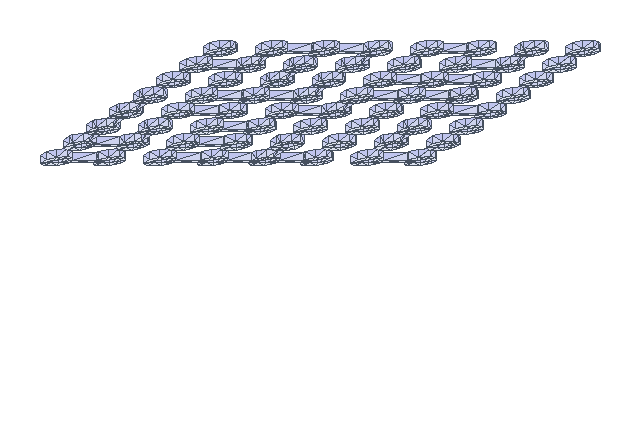

## corpus_truchet

Result: PASS.

Conversion command: `python scripts/vector_map.py /private/tmp/s36-cad-final5/corpus_truchet/source.png /private/tmp/s36-cad-final5/corpus_truchet/out.svg --input-kind image --mask /private/tmp/s36-cad-final5/corpus_truchet/mask.png --width-mm 100 --layers silhouette,structure,detail --preset relief-0.4 --export-scad --debug-bundle --json`.
Conversion exit: 0.
OpenSCAD command: `/Applications/OpenSCAD-2021.01.app/Contents/MacOS/OpenSCAD -o /private/tmp/s36-cad-final5/corpus_truchet/out.stl /private/tmp/s36-cad-final5/corpus_truchet/out.scad`.
OpenSCAD exit: 0.
Expected: `{"areas_mm2": {"canvas": 10000.0, "detail": 64.20235392445032, "silhouette": 3349.8506511894097, "structure": 3215.662491959911}, "bounds_xy": [[0.0, 0.0], [100.0, 100.0]], "filter_speckle_px": 4, "genus_sum": 20, "mask_solids": 55, "published_areas_mm2": {"canvas": 10000.0, "detail": 74.6917724609375, "silhouette": 3349.8382568359375, "structure": 3215.789794921875}, "published_volume_excess": 0.0003621890276164704, "published_volume_mm3": 5964.2181396484375, "solids": 55, "volume_basis": "effective_openscad_2d", "volume_mm3": 5962.058747388129, "z_max": 1.7999999999999998}`.
Measured: `{"bounds": [[0.0, 0.0, 0.0], [100.0, 100.0, 1.8]], "genus_per_solid": [0, 0, 0, 0, 0, 0, 0, 0, 0, 0, 0, 1, 1, 0, 1, 1, 0, 1, 1, 0, 0, 1, 0, 0, 0, 1, 1, 0, 0, 1, 0, 0, 1, 1, 1, 0, 1, 1, 1, 0, 0, 0, 0, 1, 0, 0, 1, 1, 0, 0, 1, 0, 0, 0, 0], "genus_sum": 20, "solids": 55, "volume_mm3": 5962.078701826952, "z_planes": [0.0, 1.19, 1.2, 1.4, 1.8]}`.
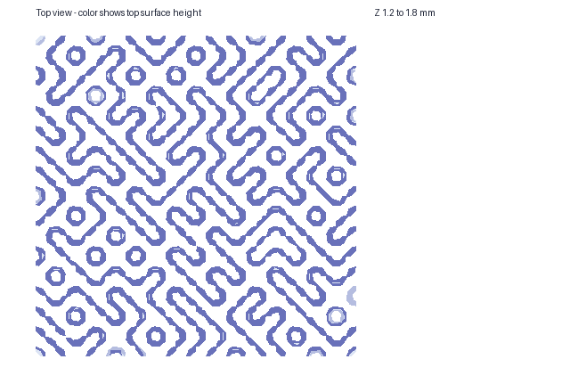

## Limits

These renders test CAD geometry on the listed fixtures.
S1.4 tracing fidelity and physical print suitability have separate evidence.

The `corpus_brick` fixture is an oblique view of a brick path. Its apparent perspective is already in the source and mask: the 256 x 256 raster is mapped uniformly onto a 100 x 100 mm XY canvas at 0.390625 mm per pixel, then traced and extruded. The top-down PNG shows that resulting planar geometry and height; it does not remove the image perspective, recover true brick dimensions, or establish the camera angle. Rectifying the path would require a calibrated image transform before mask preparation and is outside this CAD acceptance run.

## Findings and provenance

The first run of this probe, before STABL-ygtexxzr, failed five CAD rows: brick, coins, gravel, pcb and truchet. This run passes all 15. The changes are in `scripts/vector_map_cad.py`, `scripts/vector_map.py` and `scripts/vector_map_scad.py`.

Defect A (layer SVG pinches): two rings of one published layer met at a point. OpenSCAD extruded no closed wall there. A named CAD compatibility step now moves the contact points of one ring by at most 0.01 mm and a quarter pixel. A hole shrinks and an island grows, so the step adds material. `normalize_svg()` still changes no geometry.

Defect B (structure and detail point contacts): a detail ring and a structure ring met at one point, and their tops differ. That makes a vertical edge with four faces. The SCAD source now grows detail by at most 0.002 mm and a quarter pixel when such a contact exists. It subtracts a structure shrunk by the same amount. Rounding noise leaves a hairline gap between detail edges and structure edges. The gap closes to a point and gave the four-face edge in the coins corpus. A 0.01 mm growth added 1.48 mm3 to coins, above the `1e-4` tolerance, so the growth cap is 0.002 mm. The tolerance is unchanged.

The blocking volume check uses effective areas, as stated above. The published-area figure and its excess stay in each row as evidence. Brick shows 3507.553 mm3 published against 3500.369 mm3 effective.

The expected solid count skips mask components smaller than `filter_speckle` squared pixels, because the S1.4 tracer drops them. For gravel the mask has 225 components, 209 have at least 16 pixels, and the mesh has 209. The row records both counts.

The rule was then held against the real tracer at the threshold. For filter_speckle 3, 4, 5 and 6, components of speckle² − 1, speckle² and speckle² + 1 pixels were traced as a block, a line, an L and a staircase. Every count agreed with the rule. Two blocks that touch only at a corner trace as separate parts, which agrees with the 4-connected count. Below filter_speckle 3 the rule does not hold. Components of up to 4 px can trace to degenerate rings, and pixel count cannot predict which: a 1 x 4 line gives no solid, but a 2 x 2 block gives one. The probe therefore refuses filter_speckle below 3. All matrix rows use 4. `tests/test_vector_map_cad.py` keeps these checks.

Native gates in `tests/test_vector_map_cad.py` guard the repair. Per-layer extrusion checks cover Defect A. Assembled OpenSCAD mesh checks cover Defect B.

Engraved detail is outside this matrix, except for the synthetic `engraved` row. A first run of the eight corpus fixtures with `--detail-mode engraved` failed brick, gravel and truchet. Each had vertical edges with four faces in the engraving band, Z 1.0 to 1.2: one in brick, four in gravel and one in truchet. At five of these six edges the final recess met the silhouette outline at one isolated point. Cutting it leaves two material wedges that touch at that point. At the sixth, gravel (70.3125, 80.0781), the recess shares a boundary run with the outline in exact geometry. The cut was clipped to the silhouette. That intersection rounded the next recess vertex off the outline and left a hairline sliver that closes to a point.

An interim repair shrank the whole final recess by 0.002 mm when an isolated contact existed. It was replaced for two reasons. `tests/fixtures/vector_map/cad/shared_run_sliver` holds the two gravel rings at px (180, 51) alone. It has no isolated contact, so that trigger did not fire and the mesh stayed non-manifold. A groove that opens through the side wall was sealed by a 0.002 mm skin wherever the shrink applied. A trigger that also fired on shared runs would have sealed more openings, so it was not adopted.

The engraving now has two parts:

1. **Unclipped cut.** `engrave_2d()` is raw detail minus raw structure, with no silhouette clip. Cutting outside the silhouette removes nothing. The cut never shares a rounded boundary with the outline, so a shared run needs no repair, and an opening stays open. `detail_2d()` keeps its published clipped form, and the volume expectation still uses it.
2. **Local bridges.** `recess_outline_contacts()` rebuilds the final recess (detail inside the silhouette, outside structure) in the sectors around each candidate point. It reports a contact only when recess and outside sectors meet with no shared ray. At each contact, a square of half side `recess_bridge_mm()` stays uncut. The cap is 0.002 mm and a quarter pixel, the existing scale-aware cap. The run reports `cad_recess_bridge`.

Native tests in `tests/test_vector_map_cad.py` render the sliver fixture and a groove fixture. The groove fixture is a groove that opens through the wall, plus an isolated tip contact on another edge. Both render closed, and the groove floor reaches the wall. On the groove fixture, the cut with no bridges is non-manifold, and the earlier whole-recess shrink sealed the groove.

The [engraved evidence](2026-10-14-vector-map-s3-6-cad-acceptance/engraved-evidence.json) records all eight fixtures with `--detail-mode engraved`. All eight pass, with 68 manifest hashes checked and 0 mismatches. The 1e-4 volume gate is unchanged.

| Fixture | Bridges | Mesh | Volume relative to effective | Engraving-band ring-to-ring vertex contacts |
|---|---|---|---|---|
| brick | 1 | closed | -2.10e-08 | 0 |
| gravel | 7 | closed | -4.73e-08 | 0 |
| truchet | 8 | closed | 2.71e-08 | 0 |
| coins | 0 | closed | -4.02e-10 | 0 |

Badge, bracket, horse and pcb publish no detail layer, so they have no recess. The band contacts were counted on an OpenSCAD 2D export of the silhouette minus the engraving cut. A vertex of one ring on another ring there is the mark of a four-face edge.

The records below come from the earlier acceptance run and were not repeated.

The [installed-console evidence](2026-10-14-vector-map-s3-6-cad-acceptance/installed_console.json) records a fresh `./scripts[vector]` installation, dependency versions, exact argv, exit codes, and hashes for an explicit-relief corpus run, a `relief-0.4` run, and standalone mask conversion. All three conversions exited 0. The temporary venv was deleted after capture. Mask mode produced conversion artifacts only, as required by the layered-image admission rule.

Host vector-map tests: 1,417 passed and one `$HOME` sandbox failure; that exact OpenSCAD work-directory test passed when rerun with host access. The first broad host run had 2,850 passed, 18 failed, and 9 skipped while CAD rendering and the CPU container ran concurrently. A sequential host rerun of those failures gave 17 passed and one failed: the existing `test_entry_spans.py::test_an_UNHASHABLE_type_does_not_break_the_span` baseline (`STABL-fjmjolci`). The stub cohort passed 213 tests; the live cohort skipped without CUDA.

The CPU container (`docker compose -f docker-compose.test.yml run --rm test-unit`) exited 1. Its real cohort had 2,747 passed, 10 failed, 41 skipped, and 79 deselected; stub had 213 passed and live had one skip. The ten failures are the existing `test_entry_spans` case plus nine observability/logging cases caused by the test image lacking `/app/docs/observability-contract.md` and `/app/env.*` or using an unexpected default log level. The image has no OpenSCAD: the new native CAD tests skipped, while the two new non-render checks passed. The unrelated container packaging gap is `STABL-bxqlmcmf`.
