# S4.1 reviewed corpus bundles

Issue: `STABL-etpzsxvn`. Plan: [S4.1 plan](../plans/2026-10-15-vector-map-s4-1.md). Spec: [design section 10](../specs/2026-09-06-vector-map-relief-design.md).
This report is generated by `tests/vector_map_s4_1_corpus_probe.py`. Do not edit it by hand.

## Run

| Item | Value |
|---|---|
| OS | macOS-26.0.1-arm64-arm-64bit |
| Machine | arm64 arm |
| Python | 3.12.13 |
| VTracer | 0.6.15 |
| resvg-py | 0.5.0 |
| OpenSCAD | OpenSCAD version 2021.01 |
| OpenSCAD command | /Applications/OpenSCAD-2021.01.app/Contents/MacOS/OpenSCAD |
| Work directory | <work> |

Invocation: `python -m tests.vector_map_s4_1_corpus_probe --work-dir <work> --replay gravel --compare-index <earlier-index> --bundle-dir docs/superpowers/reports/2026-10-15-vector-map-s4-1-corpus --report docs/superpowers/reports/2026-10-15-vector-map-s4-1-corpus.md`.

Regenerate the evidence with the same invocation and an empty work directory.
Each case JSON holds the exact conversion argv and OpenSCAD argv.
The STL files are not committed. Rebuild one from its committed mode bundle:
`cd <case>/<mode> && openscad -o out.stl out.scad`. The SCAD imports `out.layers/*.svg` relative to itself.

## Verdict

| Check | Result |
|---|---|
| Evidence complete (16 mode rows) | True |
| Fidelity failure names equal the S1.4 pin | True |
| Raised and engraved fidelity agree | True |
| CAD rows passed | 16/16 |
| Manifest artifact hashes | 152 checked, 0 mismatches |
| Recipe replay | gravel raised PASS, gravel engraved PASS |
| Independent regeneration | PASS |
| Probe exit | 0 |

Fidelity: 4/8 cases pass the locked S1.4 checks. Probe exit 0 means the expected evidence was collected. It does not mean that every case passes.

## Release decision

`release_accepted`: true for the corpus-fidelity limitation only.
Mario accepted bracket, brick, gravel and horse as documented minimum-feature limitations on 2026-10-15 (`STABL-etpzsxvn`).
The ruling takes effect when this report and `scripts/USAGE.md` disclose the four cases and the minimum-feature risk.
Review confirms that disclosure. The probe does not compute this value.
The four cases stay FAIL. The other Sprint 4 gates still apply.

## Case results

| Case | Class | Fidelity | Failed checks | S1.4 pin | CAD raised | CAD engraved |
|---|---|---|---|---|---|---|
| badge | flat_graphic | PASS | none | none | PASS | PASS |
| bracket | line_art | FAIL | centroid | centroid | PASS | PASS |
| brick | pattern | FAIL | centroid, topology | centroid, topology | PASS | PASS |
| coins | textured_photo | PASS | none | none | PASS | PASS |
| gravel | textured_photo | FAIL | boundary, topology | boundary, topology | PASS | PASS |
| horse | flat_graphic | FAIL | centroid, topology | centroid, topology | PASS | PASS |
| pcb | line_art | PASS | none | none | PASS | PASS |
| truchet | pattern | PASS | none | none | PASS | PASS |

## Known minimum-feature limitations

These four cases fail the locked S1.4 fidelity checks. They are documented limitations, not passes.
Their reviewed masks hold foreground strokes, isthmuses, gaps or channels 1–2 processing pixels wide.
In these bundles 1–2 processing pixels are 0.390625–0.78125 mm at 0.390625 mm/px.
VTracer can lose or change features near this size. It changes topology in brick, gravel and horse.
It moves the centroid in bracket, brick and horse. It moves the gravel boundary beyond 1.5 px.
No `filter_speckle` value in the S1.4 grid fixes these cases (`tests/test_vector_map_corpus.py`).
The CLI warns about possible features below four pixels. Later research: `STABL-wuzmvgxm`.

| Case | Failed checks | Topology mask | Topology render | Centroid shift px | Boundary max px |
|---|---|---|---|---|---|
| bracket | centroid | 6, 3 | 6, 3 | 2.464 | 0.5 |
| brick | centroid, topology | 1, 53 | 5, 53 | 2.262 | 0.9142 |
| gravel | boundary, topology | 225, 13 | 208, 27 | 0.4641 | 1.736 |
| horse | centroid, topology | 1, 0 | 1, 2 | 0.851 | 0.9142 |

## Defaults assessment

The shipped fitting default is VTracer polygon mode with `filter_speckle` 4, selected by the S1.4 sweep.
`relief-0.4` is an opt-in fabrication preset. It sets relief heights only.
Resolved VTracer settings in every bundle: `{"filter_speckle": 4, "mode": "polygon"}`.
The published silhouette reproduces the S1.4 raw-trace XOR and command count in 8/8 cases.

| Case | S1.4 XOR/perimeter px | Published XOR/perimeter px | S1.4 commands | Published commands |
|---|---|---|---|---|
| badge | 0.2164 | 0.2164 | 156 | 156 |
| bracket | 0.08863 | 0.08863 | 147 | 147 |
| brick | 0.2832 | 0.2832 | 703 | 703 |
| coins | 0.1271 | 0.1271 | 341 | 341 |
| gravel | 0.2439 | 0.2439 | 2808 | 2808 |
| horse | 0.356 | 0.356 | 132 | 132 |
| pcb | 0.09947 | 0.09947 | 1082 | 1082 |
| truchet | 0.2565 | 0.2565 | 2354 | 2354 |

Recipe overrides: 0. Every row records `override_recipe: null`.
No override can repair the four limitations under the locked tolerances, because no tested speckle value passes them.
The defaults stay unchanged. No tolerance is relaxed.

## Complexity and timings

Complexity counts are paths, subpaths, commands and UTF-8 bytes. Timings are diagnostic and host-specific.
Trace and fidelity times are the median of five calls after one warm-up. Conversion and render are one call.

| Case | Mode | Silhouette cmd / B | Structure cmd / B | Detail cmd / B | Combined cmd / B | Convert s | Trace s | Fidelity s | OpenSCAD s |
|---|---|---|---|---|---|---|---|---|---|
| badge | raised | 156 / 1590 | 318 / 2809 | no layer | 474 / 4291 | 0.1244 | 0.003083 | 0.01175 | 3.24 |
| badge | engraved | 156 / 1590 | 318 / 2809 | no layer | 474 / 4291 | 0.1028 | 0.003085 | 0.01228 | 3.324 |
| bracket | raised | 147 / 1467 | 158 / 1534 | no layer | 305 / 2893 | 0.06634 | 0.003045 | 0.009626 | 2.634 |
| bracket | engraved | 147 / 1467 | 158 / 1534 | no layer | 305 / 2893 | 0.06508 | 0.002573 | 0.009526 | 2.578 |
| brick | raised | 703 / 5497 | 817 / 6242 | 5 / 234 | 1525 / 11732 | 0.297 | 0.004732 | 0.01306 | 14.36 |
| brick | engraved | 703 / 5497 | 817 / 6242 | 5 / 234 | 1525 / 11732 | 0.3446 | 0.004619 | 0.01293 | 14.12 |
| coins | raised | 341 / 3702 | 1014 / 7995 | 724 / 7067 | 2079 / 18513 | 0.1231 | 0.002609 | 0.009316 | 10.82 |
| coins | engraved | 341 / 3702 | 1014 / 7995 | 724 / 7067 | 2079 / 18513 | 0.144 | 0.002648 | 0.009313 | 16.76 |
| gravel | raised | 2808 / 28836 | 4146 / 36131 | 275 / 3945 | 7229 / 68671 | 0.6796 | 0.0103 | 0.02172 | 55.7 |
| gravel | engraved | 2808 / 28836 | 4146 / 36131 | 275 / 3945 | 7229 / 68671 | 0.9599 | 0.01018 | 0.0215 | 59.85 |
| horse | raised | 132 / 1390 | 248 / 2425 | no layer | 380 / 3702 | 0.07325 | 0.002164 | 0.008828 | 2.697 |
| horse | engraved | 132 / 1390 | 248 / 2425 | no layer | 380 / 3702 | 0.07404 | 0.002794 | 0.008606 | 2.692 |
| pcb | raised | 1082 / 8350 | 2324 / 19388 | no layer | 3406 / 27630 | 0.3143 | 0.004451 | 0.01258 | 23.08 |
| pcb | engraved | 1082 / 8350 | 2324 / 19388 | no layer | 3406 / 27630 | 0.3165 | 0.004554 | 0.0131 | 23.15 |
| truchet | raised | 2354 / 19400 | 3414 / 24622 | 124 / 1482 | 5892 / 45263 | 1.735 | 0.008483 | 0.0176 | 50.96 |
| truchet | engraved | 2354 / 19400 | 3414 / 24622 | 124 / 1482 | 5892 / 45263 | 2.022 | 0.008872 | 0.01882 | 49.83 |

## Replay and regeneration

Recipe replay reads the prepared masks (`source: map`, `prepared: true`).
It proves replay from prepared masks only. It does not prove source-image preparation.

| Case | Mode | Compared | Excluded | Differs | Result |
|---|---|---|---|---|---|
| gravel | raised | out.svg, out.layers/detail.svg, out.layers/silhouette.svg, out.layers/structure.svg, out.debug/detail.png, out.debug/silhouette.png, out.debug/structure.png, out.scad | out.preview.png | none | PASS |
| gravel | engraved | out.svg, out.layers/detail.svg, out.layers/silhouette.svg, out.layers/structure.svg, out.debug/detail.png, out.debug/silhouette.png, out.debug/structure.png, out.scad | out.preview.png | none | PASS |

An independent run from the source PNGs and reviewed masks proves preparation repeatability.
Compared against `<earlier-index>`. Rows compared: 16. Rows that differ: 0.
Excluded from the hash comparison: `out.stl`, `area-*`, `mesh.png`.

## Per-case evidence

`out.preview.png` is the CLI preview. `fidelity.png` shows the reviewed mask, the rendered published silhouette, and their XOR: gray is in both, red is in the mask only, blue is in the trace only.
`mesh.png` is a top view of the OpenSCAD mesh. Color shows the top surface height.

### badge

Class: flat_graphic. Properties: sparse, high_contrast, holes, disconnected.
Reviewed source: `tests/fixtures/vector_map/corpus/badge/source.png`, sha256 `cb4ef46bdf93f83fee6714211154ea5e58bad86e611db26094f9b2a218d1b96f`.
Reviewed mask: `tests/fixtures/vector_map/corpus/badge/mask.png`, sha256 `0dfe3e028132e38dbd792d6e92fa943dc3ed9dba4b44c637996245e75327f716`.
Fidelity: PASS (none failed).

| Metric | Value | Tolerance |
|---|---|---|
| Topology mask / render | [6, 2] / [6, 2] | exact |
| Bounds shift px | 0 | 1 |
| Box size delta px | 0 | 1 |
| Centroid shift px | 0.06814 | 0.5 |
| XOR / perimeter px | 0.2164 | 0.5 |
| Boundary max px | 0.5 | 1.5 |
| Area error / perimeter px | 0.121 | 0.5 |

**raised** — CAD PASS. Bundle: [badge/raised](2026-10-15-vector-map-s4-1-corpus/badge/raised/result.json).

Conversion: `python scripts/vector_map.py tests/fixtures/vector_map/corpus/badge/source.png <work>/badge/raised/out.svg --input-kind image --mask tests/fixtures/vector_map/corpus/badge/mask.png --width-mm 100 --layers silhouette,structure,detail --preset relief-0.4 --export-scad --debug-bundle --preview --json` (exit 0).
OpenSCAD: `/Applications/OpenSCAD-2021.01.app/Contents/MacOS/OpenSCAD -o <work>/badge/raised/out.stl <work>/badge/raised/out.scad` (exit 0).
Mesh: 6 solids (expected 6), genus 2 (expected 2), volume 4466.6329 mm³ (expected 4466.6329), Z planes [0.0, 1.2, 1.8].

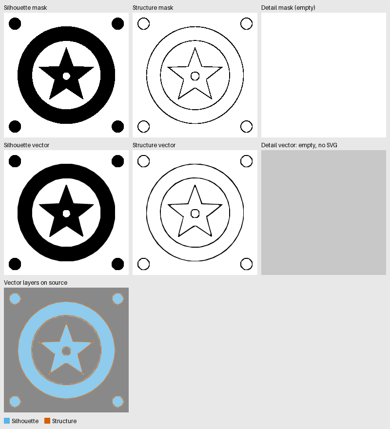

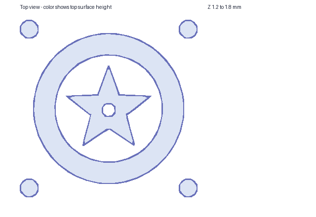

**engraved** — CAD PASS. Bundle: [badge/engraved](2026-10-15-vector-map-s4-1-corpus/badge/engraved/result.json).

Conversion: `python scripts/vector_map.py tests/fixtures/vector_map/corpus/badge/source.png <work>/badge/engraved/out.svg --input-kind image --mask tests/fixtures/vector_map/corpus/badge/mask.png --width-mm 100 --layers silhouette,structure,detail --preset relief-0.4 --detail-mode engraved --export-scad --debug-bundle --preview --json` (exit 0).
OpenSCAD: `/Applications/OpenSCAD-2021.01.app/Contents/MacOS/OpenSCAD -o <work>/badge/engraved/out.stl <work>/badge/engraved/out.scad` (exit 0).
Mesh: 6 solids (expected 6), genus 2 (expected 2), volume 4466.6329 mm³ (expected 4466.6329), Z planes [0.0, 1.2, 1.8].

### bracket

Class: line_art. Properties: sparse, high_contrast, holes, disconnected.
Reviewed source: `tests/fixtures/vector_map/corpus/bracket/source.png`, sha256 `65d5052243c582d685739030c875d8ede4539b6beae3488b29552365654f31e3`.
Reviewed mask: `tests/fixtures/vector_map/corpus/bracket/mask.png`, sha256 `9c5dea2611431c07a0d1cf0555235ba28c03a5f05c5777ebd9fb4c88cc93e1e3`.
Fidelity: FAIL (centroid failed).

| Metric | Value | Tolerance |
|---|---|---|
| Topology mask / render | [6, 3] / [6, 3] | exact |
| Bounds shift px | 0 | 1 |
| Box size delta px | 0 | 1 |
| Centroid shift px | 2.464 | 0.5 |
| XOR / perimeter px | 0.08863 | 0.5 |
| Boundary max px | 0.5 | 1.5 |
| Area error / perimeter px | 0.05059 | 0.5 |

**raised** — CAD PASS. Bundle: [bracket/raised](2026-10-15-vector-map-s4-1-corpus/bracket/raised/result.json).

Conversion: `python scripts/vector_map.py tests/fixtures/vector_map/corpus/bracket/source.png <work>/bracket/raised/out.svg --input-kind image --mask tests/fixtures/vector_map/corpus/bracket/mask.png --width-mm 100 --layers silhouette,structure,detail --preset relief-0.4 --export-scad --debug-bundle --preview --json` (exit 0).
OpenSCAD: `/Applications/OpenSCAD-2021.01.app/Contents/MacOS/OpenSCAD -o <work>/bracket/raised/out.stl <work>/bracket/raised/out.scad` (exit 0).
Mesh: 6 solids (expected 6), genus 3 (expected 3), volume 984.8928 mm³ (expected 984.8928), Z planes [0.0, 1.2, 1.8].

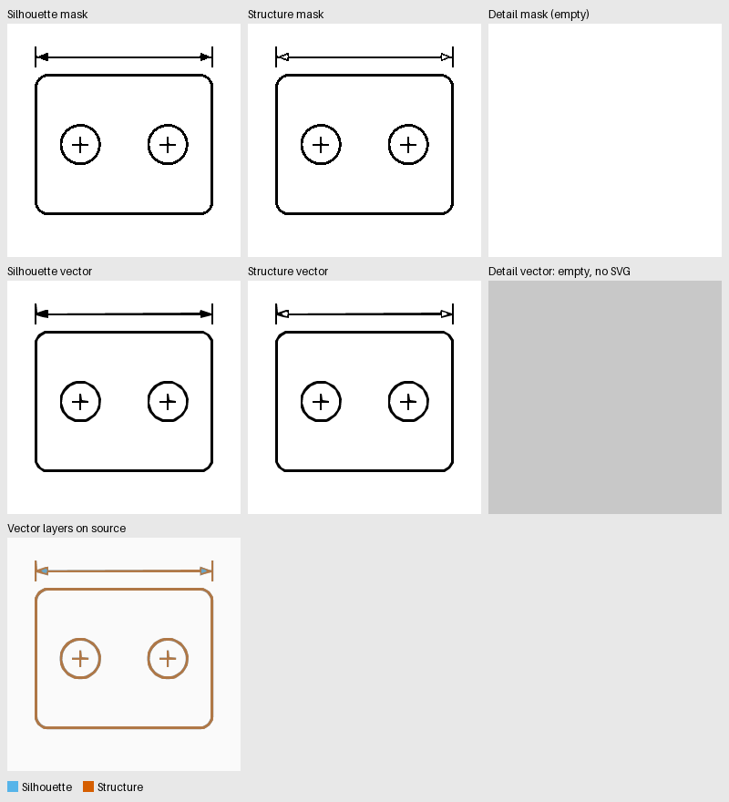
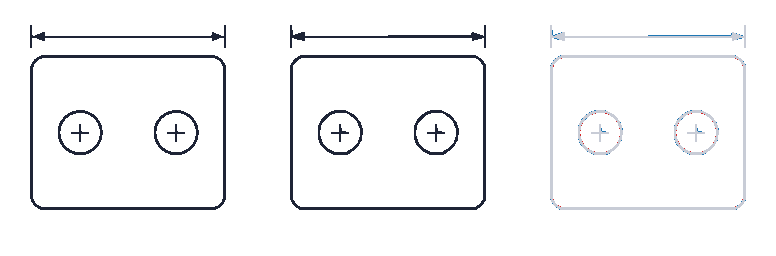
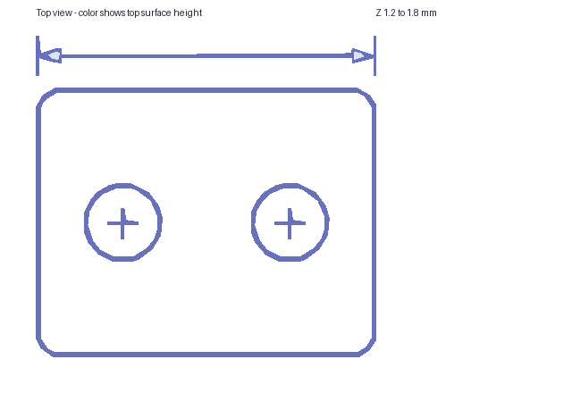

**engraved** — CAD PASS. Bundle: [bracket/engraved](2026-10-15-vector-map-s4-1-corpus/bracket/engraved/result.json).

Conversion: `python scripts/vector_map.py tests/fixtures/vector_map/corpus/bracket/source.png <work>/bracket/engraved/out.svg --input-kind image --mask tests/fixtures/vector_map/corpus/bracket/mask.png --width-mm 100 --layers silhouette,structure,detail --preset relief-0.4 --detail-mode engraved --export-scad --debug-bundle --preview --json` (exit 0).
OpenSCAD: `/Applications/OpenSCAD-2021.01.app/Contents/MacOS/OpenSCAD -o <work>/bracket/engraved/out.stl <work>/bracket/engraved/out.scad` (exit 0).
Mesh: 6 solids (expected 6), genus 3 (expected 3), volume 984.8928 mm³ (expected 984.8928), Z planes [0.0, 1.2, 1.8].

### brick

Class: pattern. Properties: dense, low_contrast, holes.
Reviewed source: `tests/fixtures/vector_map/corpus/brick/source.png`, sha256 `a8ca0820affae339011c9fd3fda99488befa6d270767a38d9f8c2a305ae72435`.
Reviewed mask: `tests/fixtures/vector_map/corpus/brick/mask.png`, sha256 `51ef2eed9776398123eb14f344294835ccb5af7529b8d41e14f0f8ddb88204fa`.
Fidelity: FAIL (centroid, topology failed).

| Metric | Value | Tolerance |
|---|---|---|
| Topology mask / render | [1, 53] / [5, 53] | exact |
| Bounds shift px | 0 | 1 |
| Box size delta px | 0 | 1 |
| Centroid shift px | 2.262 | 0.5 |
| XOR / perimeter px | 0.2832 | 0.5 |
| Boundary max px | 0.9142 | 1.5 |
| Area error / perimeter px | 0.09614 | 0.5 |

**raised** — CAD PASS. Bundle: [brick/raised](2026-10-15-vector-map-s4-1-corpus/brick/raised/result.json).

Conversion: `python scripts/vector_map.py tests/fixtures/vector_map/corpus/brick/source.png <work>/brick/raised/out.svg --input-kind image --mask tests/fixtures/vector_map/corpus/brick/mask.png --width-mm 100 --layers silhouette,structure,detail --preset relief-0.4 --export-scad --debug-bundle --preview --json` (exit 0).
OpenSCAD: `/Applications/OpenSCAD-2021.01.app/Contents/MacOS/OpenSCAD -o <work>/brick/raised/out.stl <work>/brick/raised/out.scad` (exit 0).
Mesh: 1 solids (expected 1), genus 53 (expected 53), volume 3500.3711 mm³ (expected 3500.3689), Z planes [0.0, 1.19, 1.2, 1.4, 1.8].

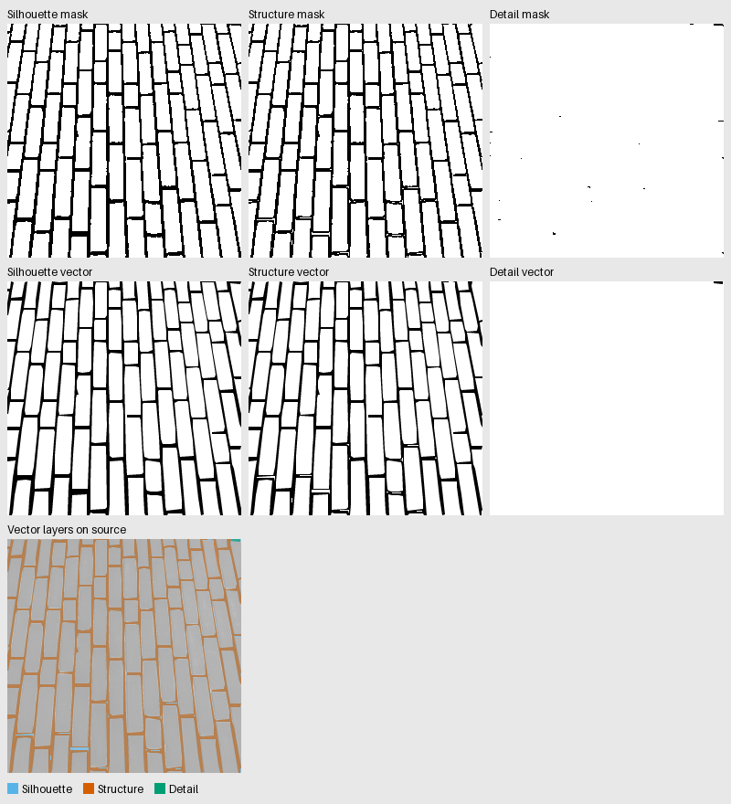
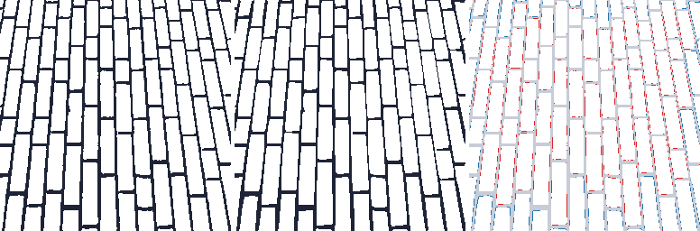
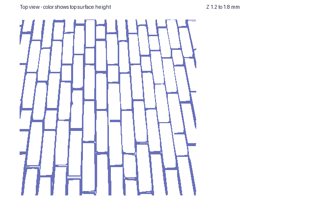

**engraved** — CAD PASS. Bundle: [brick/engraved](2026-10-15-vector-map-s4-1-corpus/brick/engraved/result.json).

Conversion: `python scripts/vector_map.py tests/fixtures/vector_map/corpus/brick/source.png <work>/brick/engraved/out.svg --input-kind image --mask tests/fixtures/vector_map/corpus/brick/mask.png --width-mm 100 --layers silhouette,structure,detail --preset relief-0.4 --detail-mode engraved --export-scad --debug-bundle --preview --json` (exit 0).
OpenSCAD: `/Applications/OpenSCAD-2021.01.app/Contents/MacOS/OpenSCAD -o <work>/brick/engraved/out.stl <work>/brick/engraved/out.scad` (exit 0).
Mesh: 1 solids (expected 1), genus 53 (expected 53), volume 3498.8430 mm³ (expected 3498.8430), Z planes [0.0, 1.0, 1.19, 1.2, 1.8].

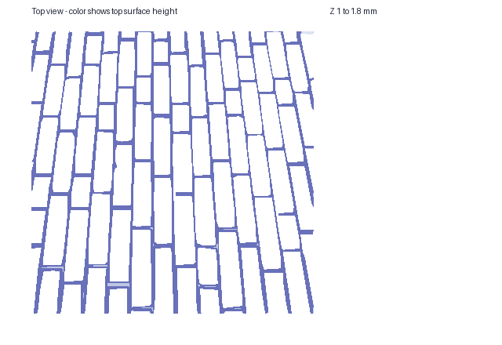

### coins

Class: textured_photo. Properties: dense, medium_contrast, disconnected.
Reviewed source: `tests/fixtures/vector_map/corpus/coins/source.png`, sha256 `c91b4fbeecb21e79033604dfe5dfc4c488ed04a6cd1d1bbf6a0be20edde231f5`.
Reviewed mask: `tests/fixtures/vector_map/corpus/coins/mask.png`, sha256 `1d62fcaff877c0702b67eaa4bb91daa218425630fcff633828b2a766a2284d3d`.
Fidelity: PASS (none failed).

| Metric | Value | Tolerance |
|---|---|---|
| Topology mask / render | [24, 0] / [24, 0] | exact |
| Bounds shift px | 0 | 1 |
| Box size delta px | 0 | 1 |
| Centroid shift px | 0.1347 | 0.5 |
| XOR / perimeter px | 0.1271 | 0.5 |
| Boundary max px | 0.5 | 1.5 |
| Area error / perimeter px | 0.1059 | 0.5 |

**raised** — CAD PASS. Bundle: [coins/raised](2026-10-15-vector-map-s4-1-corpus/coins/raised/result.json).

Conversion: `python scripts/vector_map.py tests/fixtures/vector_map/corpus/coins/source.png <work>/coins/raised/out.svg --input-kind image --mask tests/fixtures/vector_map/corpus/coins/mask.png --width-mm 100 --layers silhouette,structure,detail --preset relief-0.4 --export-scad --debug-bundle --preview --json` (exit 0).
OpenSCAD: `/Applications/OpenSCAD-2021.01.app/Contents/MacOS/OpenSCAD -o <work>/coins/raised/out.stl <work>/coins/raised/out.scad` (exit 0).
Mesh: 24 solids (expected 24), genus 0 (expected 0), volume 4369.6907 mm³ (expected 4369.3937), Z planes [0.0, 1.2, 1.4, 1.8].

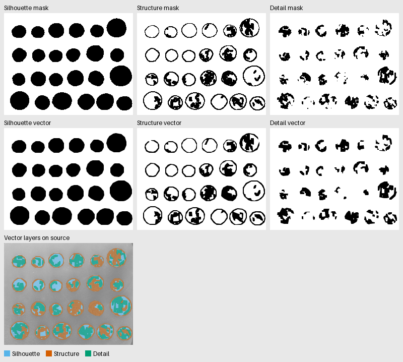
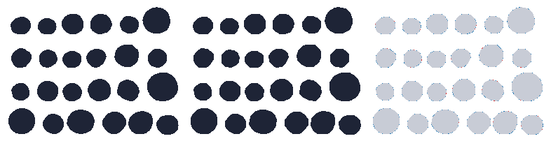
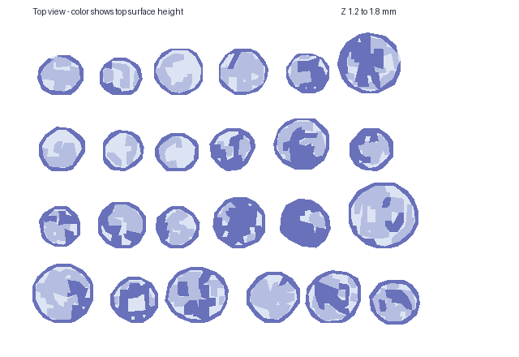

**engraved** — CAD PASS. Bundle: [coins/engraved](2026-10-15-vector-map-s4-1-corpus/coins/engraved/result.json).

Conversion: `python scripts/vector_map.py tests/fixtures/vector_map/corpus/coins/source.png <work>/coins/engraved/out.svg --input-kind image --mask tests/fixtures/vector_map/corpus/coins/mask.png --width-mm 100 --layers silhouette,structure,detail --preset relief-0.4 --detail-mode engraved --export-scad --debug-bundle --preview --json` (exit 0).
OpenSCAD: `/Applications/OpenSCAD-2021.01.app/Contents/MacOS/OpenSCAD -o <work>/coins/engraved/out.stl <work>/coins/engraved/out.scad` (exit 0).
Mesh: 24 solids (expected 24), genus 0 (expected 0), volume 3998.3201 mm³ (expected 3998.3201), Z planes [0.0, 1.0, 1.19, 1.2, 1.8].

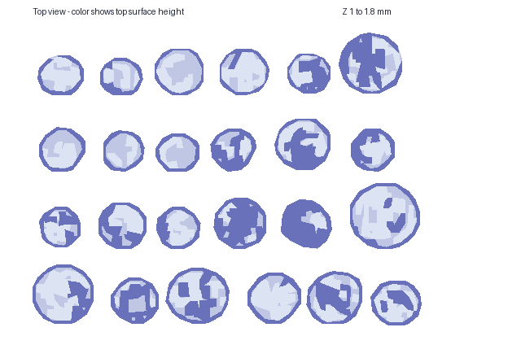

### gravel

Class: textured_photo. Properties: dense, low_contrast, holes, disconnected.
Reviewed source: `tests/fixtures/vector_map/corpus/gravel/source.png`, sha256 `bde930e5875863e7d14ac47e4497211ab2e8cd3fecfd8302a688ee1c94d37543`.
Reviewed mask: `tests/fixtures/vector_map/corpus/gravel/mask.png`, sha256 `66b7c0430264adb286f0c89a266a53f68e831e379fbcc5cd5ae1c27d4812e0c3`.
Fidelity: FAIL (boundary, topology failed).

| Metric | Value | Tolerance |
|---|---|---|
| Topology mask / render | [225, 13] / [208, 27] | exact |
| Bounds shift px | 0 | 1 |
| Box size delta px | 0 | 1 |
| Centroid shift px | 0.4641 | 0.5 |
| XOR / perimeter px | 0.2439 | 0.5 |
| Boundary max px | 1.736 | 1.5 |
| Area error / perimeter px | 0.08746 | 0.5 |

**raised** — CAD PASS. Bundle: [gravel/raised](2026-10-15-vector-map-s4-1-corpus/gravel/raised/result.json).

Conversion: `python scripts/vector_map.py tests/fixtures/vector_map/corpus/gravel/source.png <work>/gravel/raised/out.svg --input-kind image --mask tests/fixtures/vector_map/corpus/gravel/mask.png --width-mm 100 --layers silhouette,structure,detail --preset relief-0.4 --export-scad --debug-bundle --preview --json` (exit 0).
OpenSCAD: `/Applications/OpenSCAD-2021.01.app/Contents/MacOS/OpenSCAD -o <work>/gravel/raised/out.stl <work>/gravel/raised/out.scad` (exit 0).
Mesh: 209 solids (expected 209), genus 13 (expected 13), volume 7043.8749 mm³ (expected 7043.7904), Z planes [0.0, 1.19, 1.2, 1.4, 1.8].

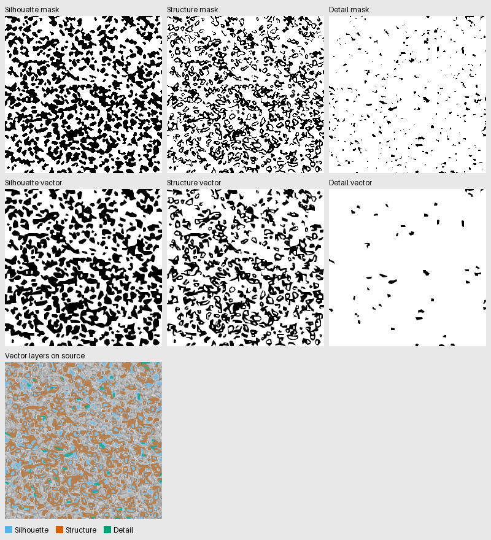
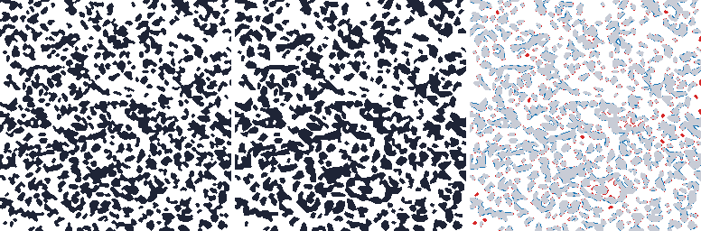

**engraved** — CAD PASS. Bundle: [gravel/engraved](2026-10-15-vector-map-s4-1-corpus/gravel/engraved/result.json).

Conversion: `python scripts/vector_map.py tests/fixtures/vector_map/corpus/gravel/source.png <work>/gravel/engraved/out.svg --input-kind image --mask tests/fixtures/vector_map/corpus/gravel/mask.png --width-mm 100 --layers silhouette,structure,detail --preset relief-0.4 --detail-mode engraved --export-scad --debug-bundle --preview --json` (exit 0).
OpenSCAD: `/Applications/OpenSCAD-2021.01.app/Contents/MacOS/OpenSCAD -o <work>/gravel/engraved/out.stl <work>/gravel/engraved/out.scad` (exit 0).
Mesh: 209 solids (expected 209), genus 13 (expected 13), volume 6987.1180 mm³ (expected 6987.1183), Z planes [0.0, 1.0, 1.19, 1.2, 1.8].

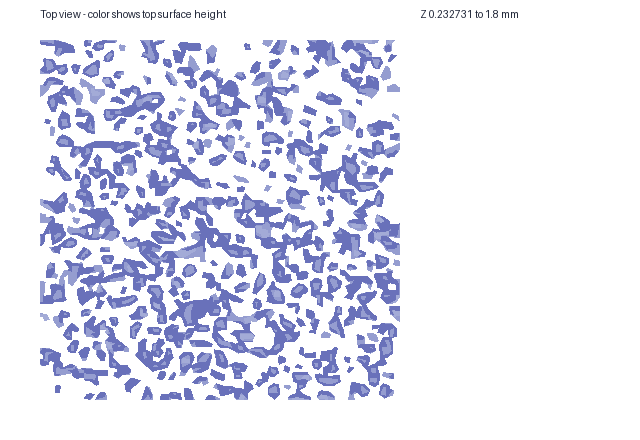

### horse

Class: flat_graphic. Properties: sparse, high_contrast.
Reviewed source: `tests/fixtures/vector_map/corpus/horse/source.png`, sha256 `a375f31da5d9c8c76c59be048bc0737dc54377a88aa2e158696b1d8981aa936d`.
Reviewed mask: `tests/fixtures/vector_map/corpus/horse/mask.png`, sha256 `33806d96a76a5b227405d25e47aabe0f64694b16f1d1ecd2e92e08c57e195c6f`.
Fidelity: FAIL (centroid, topology failed).

| Metric | Value | Tolerance |
|---|---|---|
| Topology mask / render | [1, 0] / [1, 2] | exact |
| Bounds shift px | 0 | 1 |
| Box size delta px | 0 | 1 |
| Centroid shift px | 0.851 | 0.5 |
| XOR / perimeter px | 0.356 | 0.5 |
| Boundary max px | 0.9142 | 1.5 |
| Area error / perimeter px | 0.3515 | 0.5 |

**raised** — CAD PASS. Bundle: [horse/raised](2026-10-15-vector-map-s4-1-corpus/horse/raised/result.json).

Conversion: `python scripts/vector_map.py tests/fixtures/vector_map/corpus/horse/source.png <work>/horse/raised/out.svg --input-kind image --mask tests/fixtures/vector_map/corpus/horse/mask.png --width-mm 100 --layers silhouette,structure,detail --preset relief-0.4 --export-scad --debug-bundle --preview --json` (exit 0).
OpenSCAD: `/Applications/OpenSCAD-2021.01.app/Contents/MacOS/OpenSCAD -o <work>/horse/raised/out.stl <work>/horse/raised/out.scad` (exit 0).
Mesh: 1 solids (expected 1), genus 0 (expected 0), volume 3586.9440 mm³ (expected 3586.9440), Z planes [0.0, 1.2, 1.8].

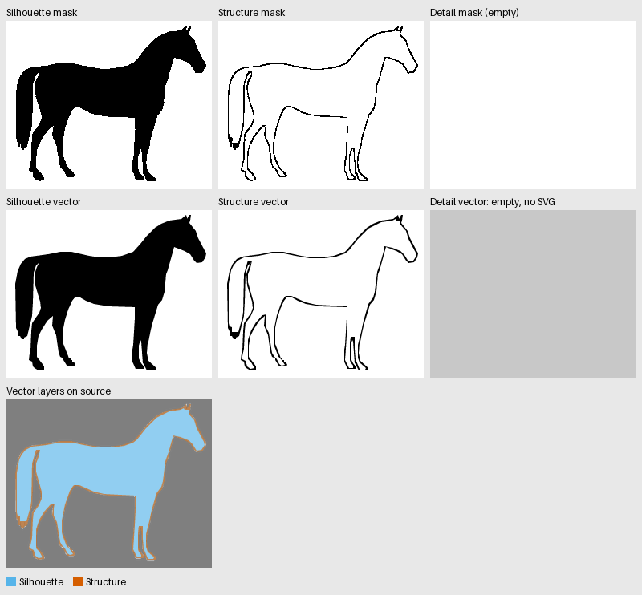
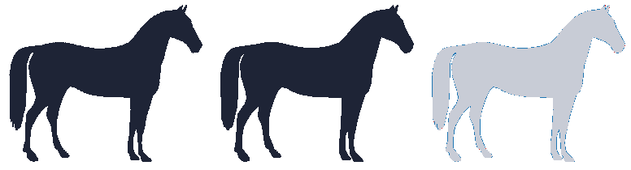

**engraved** — CAD PASS. Bundle: [horse/engraved](2026-10-15-vector-map-s4-1-corpus/horse/engraved/result.json).

Conversion: `python scripts/vector_map.py tests/fixtures/vector_map/corpus/horse/source.png <work>/horse/engraved/out.svg --input-kind image --mask tests/fixtures/vector_map/corpus/horse/mask.png --width-mm 100 --layers silhouette,structure,detail --preset relief-0.4 --detail-mode engraved --export-scad --debug-bundle --preview --json` (exit 0).
OpenSCAD: `/Applications/OpenSCAD-2021.01.app/Contents/MacOS/OpenSCAD -o <work>/horse/engraved/out.stl <work>/horse/engraved/out.scad` (exit 0).
Mesh: 1 solids (expected 1), genus 0 (expected 0), volume 3586.9440 mm³ (expected 3586.9440), Z planes [0.0, 1.2, 1.8].

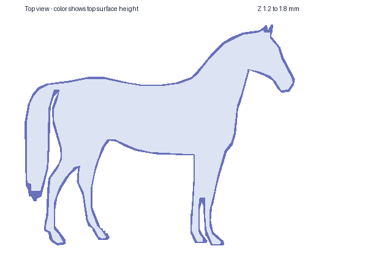

### pcb

Class: line_art. Properties: dense, high_contrast, holes, disconnected.
Reviewed source: `tests/fixtures/vector_map/corpus/pcb/source.png`, sha256 `6da388d59804395ecfded06b97b3279baac0caf2dd7ec9db208e4f4bbd698c3c`.
Reviewed mask: `tests/fixtures/vector_map/corpus/pcb/mask.png`, sha256 `001b22f13bfe54a170f3729e3e43209a3b8590414eb82a114777e95897de9222`.
Fidelity: PASS (none failed).

| Metric | Value | Tolerance |
|---|---|---|
| Topology mask / render | [30, 64] / [30, 64] | exact |
| Bounds shift px | 0 | 1 |
| Box size delta px | 0 | 1 |
| Centroid shift px | 0.08305 | 0.5 |
| XOR / perimeter px | 0.09947 | 0.5 |
| Boundary max px | 0.5 | 1.5 |
| Area error / perimeter px | 0.02294 | 0.5 |

**raised** — CAD PASS. Bundle: [pcb/raised](2026-10-15-vector-map-s4-1-corpus/pcb/raised/result.json).

Conversion: `python scripts/vector_map.py tests/fixtures/vector_map/corpus/pcb/source.png <work>/pcb/raised/out.svg --input-kind image --mask tests/fixtures/vector_map/corpus/pcb/mask.png --width-mm 100 --layers silhouette,structure,detail --preset relief-0.4 --export-scad --debug-bundle --preview --json` (exit 0).
OpenSCAD: `/Applications/OpenSCAD-2021.01.app/Contents/MacOS/OpenSCAD -o <work>/pcb/raised/out.stl <work>/pcb/raised/out.scad` (exit 0).
Mesh: 30 solids (expected 30), genus 64 (expected 64), volume 3600.1625 mm³ (expected 3600.1625), Z planes [0.0, 1.2, 1.8].

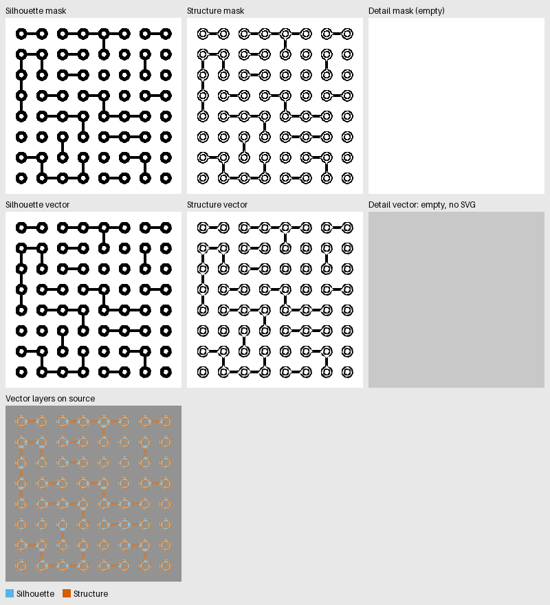
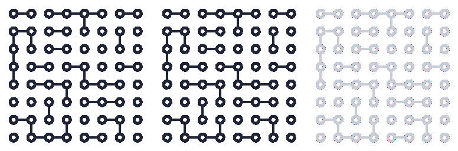

**engraved** — CAD PASS. Bundle: [pcb/engraved](2026-10-15-vector-map-s4-1-corpus/pcb/engraved/result.json).

Conversion: `python scripts/vector_map.py tests/fixtures/vector_map/corpus/pcb/source.png <work>/pcb/engraved/out.svg --input-kind image --mask tests/fixtures/vector_map/corpus/pcb/mask.png --width-mm 100 --layers silhouette,structure,detail --preset relief-0.4 --detail-mode engraved --export-scad --debug-bundle --preview --json` (exit 0).
OpenSCAD: `/Applications/OpenSCAD-2021.01.app/Contents/MacOS/OpenSCAD -o <work>/pcb/engraved/out.stl <work>/pcb/engraved/out.scad` (exit 0).
Mesh: 30 solids (expected 30), genus 64 (expected 64), volume 3600.1625 mm³ (expected 3600.1625), Z planes [0.0, 1.2, 1.8].

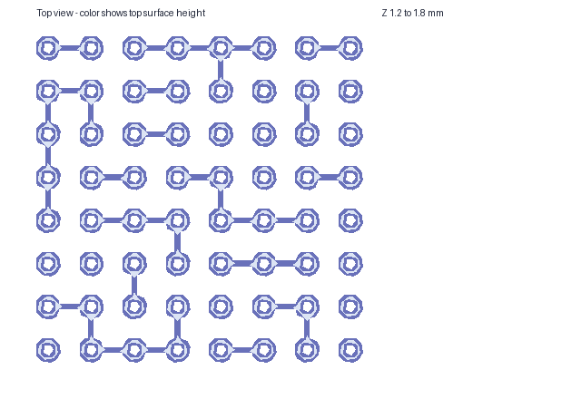

### truchet

Class: pattern. Properties: dense, low_contrast, holes, disconnected.
Reviewed source: `tests/fixtures/vector_map/corpus/truchet/source.png`, sha256 `ad44bf5e3b1df9824f4273dae2c29463e54e4377b01b41396cfafe2ed91d0c51`.
Reviewed mask: `tests/fixtures/vector_map/corpus/truchet/mask.png`, sha256 `0f79f95ba662f9da5db1652ec9668980fe632836566a84dc82e70203d9470a39`.
Fidelity: PASS (none failed).

| Metric | Value | Tolerance |
|---|---|---|
| Topology mask / render | [55, 20] / [55, 20] | exact |
| Bounds shift px | 0 | 1 |
| Box size delta px | 0 | 1 |
| Centroid shift px | 0.07442 | 0.5 |
| XOR / perimeter px | 0.2565 | 0.5 |
| Boundary max px | 1.5 | 1.5 |
| Area error / perimeter px | 0.1763 | 0.5 |

**raised** — CAD PASS. Bundle: [truchet/raised](2026-10-15-vector-map-s4-1-corpus/truchet/raised/result.json).

Conversion: `python scripts/vector_map.py tests/fixtures/vector_map/corpus/truchet/source.png <work>/truchet/raised/out.svg --input-kind image --mask tests/fixtures/vector_map/corpus/truchet/mask.png --width-mm 100 --layers silhouette,structure,detail --preset relief-0.4 --export-scad --debug-bundle --preview --json` (exit 0).
OpenSCAD: `/Applications/OpenSCAD-2021.01.app/Contents/MacOS/OpenSCAD -o <work>/truchet/raised/out.stl <work>/truchet/raised/out.scad` (exit 0).
Mesh: 55 solids (expected 55), genus 20 (expected 20), volume 5962.0787 mm³ (expected 5962.0587), Z planes [0.0, 1.19, 1.2, 1.4, 1.8].

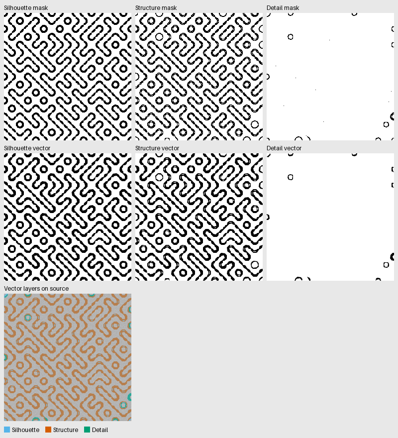
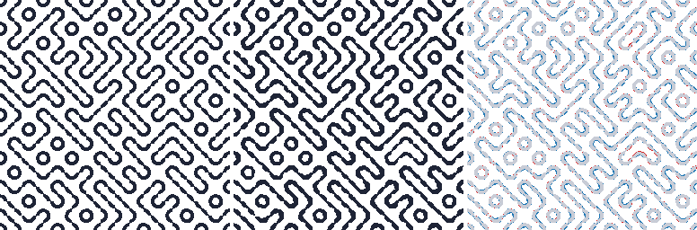
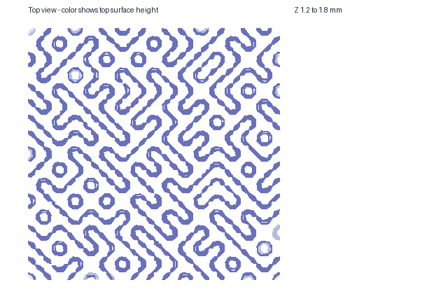

**engraved** — CAD PASS. Bundle: [truchet/engraved](2026-10-15-vector-map-s4-1-corpus/truchet/engraved/result.json).

Conversion: `python scripts/vector_map.py tests/fixtures/vector_map/corpus/truchet/source.png <work>/truchet/engraved/out.svg --input-kind image --mask tests/fixtures/vector_map/corpus/truchet/mask.png --width-mm 100 --layers silhouette,structure,detail --preset relief-0.4 --detail-mode engraved --export-scad --debug-bundle --preview --json` (exit 0).
OpenSCAD: `/Applications/OpenSCAD-2021.01.app/Contents/MacOS/OpenSCAD -o <work>/truchet/engraved/out.stl <work>/truchet/engraved/out.scad` (exit 0).
Mesh: 55 solids (expected 55), genus 20 (expected 20), volume 5936.3780 mm³ (expected 5936.3778), Z planes [0.0, 1.0, 1.19, 1.2, 1.8].

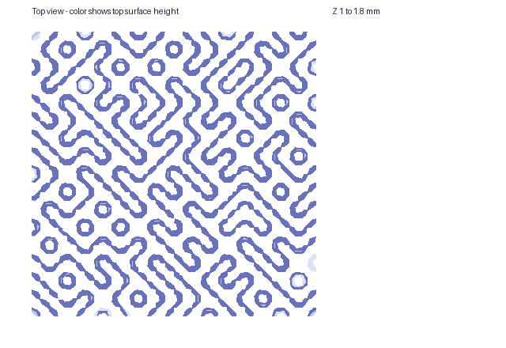

## Not covered

Slicer observations and print review belong to S4.5. Print validation is pending.
The blocking CAD volume uses OpenSCAD effective 2D areas. It checks the 3D assembly, heights and closure.
It does not independently check the 2D clip. Each case JSON keeps the published-area figure beside it.
Baseline test failures `STABL-fjmjolci` and `STABL-bxqlmcmf` are not corpus results.
